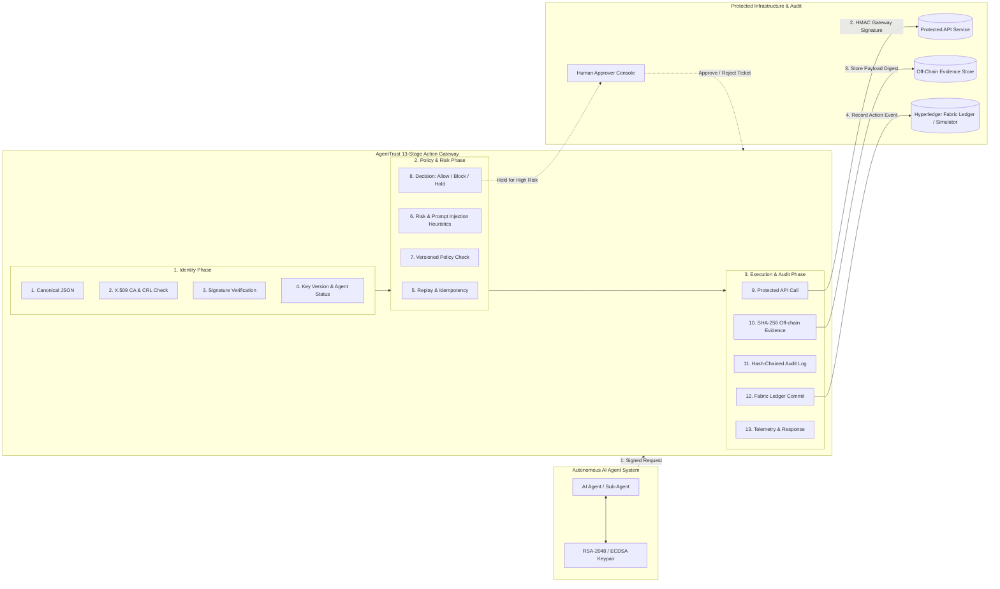

<div align="center">

# 🛡️ AgentTrust

### **Verifiable Identity, Bounded Authorization, and Tamper-Evident Accountability for Autonomous AI Agents**

[](https://www.python.org/)
[](https://fastapi.tiangolo.com/)
[](https://nextjs.org/)
[](https://www.hyperledger.org/use/fabric)
[](LICENSE)
[](tests/)
[](documentation/security_model.md)
[](attack_lab/)
[](benchmarks/DATASET_PROVENANCE.md)

[Key Features](#-key-features) •
[Architecture](#-architecture) •
[13-Stage Pipeline](#-the-13-stage-gateway-pipeline) •
[Quick Start](#-quick-start) •
[Evaluation & Benchmarks](#-empirical-security-evaluation--benchmarks) •
[Attack Lab](#-attack-lab-matrix) •
[Documentation](#-documentation)

</div>

---

> ### 🛡️ AgentTrust — Security Assurance and Distributed Recovery
> **AgentTrust is a modular security gateway for autonomous AI agents, combining cryptographic identity verification, policy enforcement, replay protection, durable transaction intents, idempotency controls, and auditable ledger reconciliation.**
>
> Its reported test suite covers adversarial authorization, financial input canonicalization, cross-process concurrency, leased locks with fencing tokens, crash recovery, uncertain external outcomes, and reconciliation races. The latest reported regression baseline is **160 passing tests and 2 skipped**, with clean Ruff linting and mypy type checking.
>
> The architecture targets durable reconciliation with at-most-once execution under explicitly defined downstream and persistence assumptions. Production readiness and real-network Hyperledger Fabric guarantees remain subject to independent verification and live integration testing.

---

## 📌 Why AgentTrust?

Autonomous AI agents are transitioning from conversational assistants to active operational tools—executing financial transactions, issuing purchase orders, modifying databases, and calling external enterprise APIs.

Standard security controls (API keys, static OAuth tokens, simple role-based access) fall short when securing AI agents:

| Vulnerability Gap | The Problem | How AgentTrust Solves It |
| :--- | :--- | :--- |
| **Shared Identity** | Agents share static API tokens, preventing cryptographic non-repudiation or per-agent revocation. | **X.509 PKI & Asymmetric Key Lifecycle**: Short-lived or hardware-backed RSA-2048/ECDSA keys with revocation lists (CRL) and key versioning. |
| **Unbounded Scope** | Prompt injection or model hallucinations can trick an agent into executing unauthorized API calls. | **13-Stage Action Gateway & Versioned Policies**: Enforces fine-grained monetary caps, resource scopes, allowed actions, and working hour bounds before API execution. |
| **Confused Deputy & Tool Exploits** | Sub-agents or tool calls execute unintended actions beyond original user intent. | **Intent-Bound MCP Governance & Delegation Tokens**: Scopes sub-agent delegated permissions with cryptographic delegation chains and parameter binding. |
| **Single-DB Audit Logs** | Centralized audit logs can be modified or deleted by compromised admins post-facto. | **Off-Chain Evidence & Hash-Chained Ledger**: SHA-256 evidence digests chained locally with Merkle inclusion proofs and committed to a permissioned ledger. |

---

## ✨ Key Features

- 🔐 **Cryptographic Identity (X.509 PKI)**
  - Root Certificate Authority (CA), RSA-2048 (RSA-PSS) and ECDSA digital signatures.
  - Full lifecycle management (`ACTIVE`, `SUSPENDED`, `REVOKED`), Certificate Revocation List (CRL), key versioning, and zero-trust agent key generation (private key never touches the gateway).

- ⚡ **13-Stage Action Gateway**
  - Rigid multi-phase execution pipeline (Identity Verification → Policy & Risk Checks → Human Approval → Direct API Execution → Off-chain Digest → Ledger Commit).
  - HMAC signed gateway headers preventing direct protected API bypass (`X-Gateway-Signature`).

- 🧠 **MCP & Tool-Call Governance**
  - Model Context Protocol (MCP) governance adapter (`action_gateway/mcp_adapter.py`) preventing confused deputy attacks by binding tool names and parameters directly to signed agent intent.

- 🎟️ **Human-in-the-Loop Approval Workflow**
  - Automated hold-for-approval on high-risk requests. Single-use, cryptographically bound approval tokens with full re-validation of agent status, key version, and policy bounds upon resumption (preventing TOCTOU vulnerabilities).

- 📜 **Delegation Token Management**
  - Cryptographically signed delegation chains (`identity_manager/delegation_tokens.py`) enabling primary agents to safely delegate restricted sub-tasks to sub-agents with non-negotiable audience and monetary limits.

- 🧬 **Tamper-Evident Evidence & Merkle Verifier**
  - Raw request/response payloads stored in an off-chain evidence store. SHA-256 digests recorded in a local cryptographic hash-chain and permissioned ledger.
  - Independent `auditor_cli.py` command line tool to verify evidence authenticity via Merkle inclusion proofs.

- 🛡️ **20-Scenario Adversarial Attack Lab**
  - Built-in adversarial test harness (`attack_lab/`) covering forged signatures, payload tampering, replay attacks, time-skew attacks, approval token substitution, evidence tampering, and concurrent audit write conflicts.

- 💾 **SQLite State Persistence & Restart Recovery**
  - Full SQLite database layer (`agenttrust_persistent.db`) hydrating agent registry state, CRLs, active policies, replay nonces, approval tickets, and audit logs across server restarts.

- 📊 **Dual Monitoring Interfaces**
  - Built-in real-time HTML security dashboard served at `/` with interactive live demo controls and attack-lab runner.
  - Next.js 14 + TypeScript enterprise dashboard in `frontend/`.

---

## 🏗️ Architecture

AgentTrust acts as a zero-trust security gateway between Autonomous AI Agents and Protected Enterprise APIs.



---

## 🔄 The 13-Stage Gateway Pipeline

Every incoming agent request must navigate through 13 sequential security stages before reaching a protected API endpoint:

| Phase | Stage # | Stage Name | Security Function |
| :--- | :---: | :--- | :--- |
| **Identity** | 1 | **Canonicalization & Validation** | Normalizes JSON key order, whitespace, and payload schemas to guarantee invariant signature verification. |
| | 2 | **X.509 Certificate Check** | Verifies root CA signature, validity period, and checks Certificate Revocation List (CRL). |
| | 3 | **Digital Signature Verification** | Validates RSA-PSS or ECDSA signature over canonical payload using the agent's registered public key. |
| | 4 | **Agent & Key Status** | Ensures agent status is `ACTIVE` and key version matches the active registration. |
| **Policy & Risk** | 5 | **Replay & Idempotency Protection** | Verifies timestamp freshness (within skew window), checks unique nonces, and evaluates per-agent idempotency keys. |
| | 6 | **Risk & Prompt Injection Scoring** | Computes multi-factor risk score combining amount threshold, resource risk, frequency, and prompt-injection pattern heuristics. |
| | 7 | **Versioned Policy Engine** | Evaluates per-agent policies (allowed actions, resource constraints, monetary limits, normalized UTC working hours). |
| | 8 | **Decision Gate** | Determines action outcome: `ALLOW` (immediate execution), `BLOCK` (policy denial), or `HOLD_FOR_APPROVAL` (ticket issued). |
| **Execution & Audit** | 9 | **Protected API Execution** | Dispatches request to target API injected with secret HMAC `X-Gateway-Signature` header to prevent direct access bypass. |
| | 10 | **Off-Chain Evidence Generation** | Computes SHA-256 digest of input payload and response body; stores raw evidence in evidence manager. |
| | 11 | **Hash-Chained Audit Logging** | Appends SHA-256 hashed audit record into local tamper-evident cryptographic hash-chain. |
| | 12 | **Ledger State Commit** | Invokes `RecordActionEvent` on the Fabric ledger (or simulator), persisting the proof immutably on-chain. |
| | 13 | **Response & Telemetry** | Emits audit event telemetry and returns signed gateway response to the requesting agent. |

---

## ⚡ Operational Modes

AgentTrust supports four operational modes for benchmarking, demonstration, and enterprise deployment:

| Operational Mode | Security Gateway | Replay & Policy Check | Hash-Chained Audit | Ledger Commit | Purpose |
| :--- | :---: | :---: | :---: | :---: | :--- |
| `MODE_A_DIRECT_API` | ❌ Disabled | ❌ Disabled | ❌ Disabled | ❌ Disabled | Baseline latency & throughput benchmark |
| `MODE_B_AUTH_RBAC` | ⚠️ Basic HTTP Auth | ❌ Disabled | ❌ Disabled | ❌ Disabled | Simple static role-based baseline |
| `MODE_C_AGENTTRUST_NO_FABRIC` | ✅ Full 13-Stage | ✅ Enforced | ✅ Hash-Chain Log | ❌ Disabled | High-throughput local gateway deployment |
| `MODE_D_AGENTTRUST_FABRIC` | ✅ Full 13-Stage | ✅ Enforced | ✅ Hash-Chain Log | ✅ Fabric Ledger | Complete tamper-evident enterprise mode (Default) |

---

## 🚀 Quick Start

### 1. System Requirements

- **Python**: 3.11 or higher
- **Node.js**: 20+ (required only for Next.js console in `frontend/`)
- **Docker & Docker Compose**: (Optional, for containerized deployment)

### 2. Installation & Environment Setup

```bash
# Clone repository
git clone https://github.com/venkatesh0029/AgentTrust.git
cd AgentTrust

# Create & activate virtual environment
python -m venv .venv
# On Linux/macOS:
source .venv/bin/activate
# On Windows:
.venv\Scripts\activate

# Install dependencies
pip install -r requirements.txt
```

### 3. Environment Configuration

Export production secrets or use generated cryptographic keys:

```bash
# Set secure secrets (Linux/macOS)
export AGENTTRUST_JWT_SECRET="$(openssl rand -hex 32)"
export GATEWAY_SECRET="$(openssl rand -hex 32)"
export KEY_STORAGE_PASSPHRASE="$(openssl rand -hex 32)"

# PowerShell (Windows)
$env:AGENTTRUST_JWT_SECRET="e9a8f4c2..."
$env:GATEWAY_SECRET="3b1d7a9f..."
$env:KEY_STORAGE_PASSPHRASE="0f8c2e1a..."
```

### 4. Launch the Server & Built-in Dashboard

```bash
uvicorn server:app --reload --port 8000
```

- 🌐 **Interactive Security Dashboard**: [http://localhost:8000](http://localhost:8000)
- 📚 **Interactive Swagger API Docs**: [http://localhost:8000/docs](http://localhost:8000/docs)
- 📖 **ReDoc API Specifications**: [http://localhost:8000/redoc](http://localhost:8000/redoc)

### 5. Running with Docker Compose

```bash
docker compose up --build
```

---

## 💻 Python SDK Usage

The Python SDK (`agenttrust_sdk`) simplifies registering agents, signing payloads, and executing secure gateway actions.

### Register an Agent & Submit a Signed Request

```python
import rsa
from agenttrust_sdk.agent_guard import AgentGuard

# Initialize SDK client connected to the AgentTrust Gateway
guard = AgentGuard(gateway_url="http://localhost:8000")

# 1. Register agent identity with asymmetric keys
pubkey, privkey = rsa.newkeys(2048)
agent_info = guard.register_agent(
    agent_id="finance-agent-01",
    public_key_pem=pubkey.save_pkcs1().decode('utf-8'),
    roles=["PAYMENT_PROCESSOR"]
)
print(f"Agent registered: {agent_info['agent_id']} (Status: {agent_info['status']})")

# 2. Submit a cryptographically signed action through the 13-stage gateway
response = guard.submit_action(
    agent_id="finance-agent-01",
    private_key_pem=privkey.save_pkcs1().decode('utf-8'),
    action="transfer_funds",
    resource="account-9876",
    amount=450.00,
    parameters={"recipient": "vendor-corp", "currency": "USD"}
)

print(f"Gateway Decision: {response['decision']} | Transaction ID: {response['request_id']}")
```

---

## 🔍 Independent Auditor CLI

Audit logs and off-chain evidence digests can be verified independently without trusting the central server, using Merkle inclusion proofs:

```bash
# Verify that an evidence JSON file matches an on-chain Merkle root proof
python auditor_cli.py \
  --verify-proof \
  --evidence evidence_rec_1001.json \
  --root 9f8a3c... \
  --proof proof_1001.json
```

Output:
```text
[+] Evidence Hash: a5c8e4f1b...
[+] Verification Result: SUCCESS (Evidence integrity verified against Merkle Root)
```

---

## 🧪 Adversarial Attack Lab (20 Scenarios)

AgentTrust features a comprehensive attack matrix evaluating system resilience against 20 distinct adversarial threat scenarios:

| # | Attack Scenario | Threat Description | Gateway Prevention Mechanism |
| :-: | :--- | :--- | :--- |
| **01** | Forged Signature | Attacker attempts to sign payload using an unregistered key pair. | **Stage 3**: Signature verification fails (`INVALID_SIGNATURE`). |
| **02** | Payload Tampering | Attacker modifies amount/recipient after generating digital signature. | **Stage 1 & 3**: Canonical JSON hash mismatch (`SIGNATURE_MISMATCH`). |
| **03** | Replay Attack | Attacker re-submits a valid signed request packet. | **Stage 5**: Nonce and timestamp tracking rejects duplicate (`REPLAY_DETECTED`). |
| **04** | Expired Request | Attacker submits a request outside allowed time-skew window. | **Stage 5**: Timestamp freshness check fails (`REQUEST_EXPIRED`). |
| **05** | Duplicate Request | Submitting duplicate transaction with same idempotency key. | **Stage 5**: Idempotency manager returns existing result without re-execution. |
| **06** | Revoked Agent | Revoked agent attempts to execute an authorized API action. | **Stage 4**: Certificate Revocation List (CRL) check denies access (`AGENT_REVOKED`). |
| **07** | Suspended Agent | Suspended agent attempts action during administrative hold. | **Stage 4**: Lifecycle check blocks execution (`AGENT_SUSPENDED`). |
| **08** | Unauthorized Action | Agent attempts action not permitted in its policy. | **Stage 7**: Policy engine denies action (`ACTION_NOT_PERMITTED`). |
| **09** | Policy Bypass | Agent attempts monetary transaction exceeding policy caps. | **Stage 7**: Amount threshold check denies request (`EXCEEDS_POLICY_CAP`). |
| **10** | Risk Score Spoofing | Attacker sends client-side `risk_score=0.0` header. | **Stage 6**: Server re-computes risk score independently, ignoring client headers. |
| **11** | Approval Tampering | Client sends `status="APPROVED"` without approval ticket. | **Stage 8**: Gate checks approval ticket in tickets table (`TICKET_REQUIRED`). |
| **12** | Approval Token Replay | Re-submitting an already used single-use approval ticket. | **Stage 8**: Ticket state check detects consumed ticket (`TICKET_ALREADY_USED`). |
| **13** | Ticket Substitution | Attacker uses Approval Ticket A for Request B. | **Stage 8**: Ticket request payload binding validation fails (`TICKET_MISMATCH`). |
| **14** | Modification Post-Approval | Attacker alters payload between human approval and resumption. | **Stage 8**: Re-canonicalization & policy check detects drift (`PAYLOAD_ALTERED`). |
| **15** | Direct API Bypass | Attacker bypasses gateway to hit `/protected-api/` directly. | **Protected API**: Rejects requests lacking HMAC `X-Gateway-Signature` secret. |
| **16** | Evidence Tampering | Attacker alters raw JSON stored in off-chain evidence store. | **Evidence Verifier**: Hash check against ledger SHA-256 fails (`EVIDENCE_TAMPERED`). |
| **17** | Hash-Chain Tampering | Modifying a historical block in local audit log file. | **Audit Writer**: Hash-chain pointer verification fails (`HASH_CHAIN_BROKEN`). |
| **18** | Unauthorized Ledger Write | Direct write attempt to Fabric ledger simulator without gateway credentials. | **Ledger Service**: Role-based key authorization rejects write (`UNAUTHORIZED_WRITE`). |
| **19** | Key Compromise Recovery | Immediate key rotation and revocation flow upon private key leak. | **Identity Manager**: Revokes old key version and issues new cert version. |
| **20** | Concurrent Audit Conflict | Simultaneous execution requests writing to audit log. | **Audit Writer**: Thread-safe queue & mutex locks prevent race conditions. |

Run the full attack matrix via terminal:

```bash
pytest attack_lab/test_attack_lab.py -v
```

Or via API:
```bash
curl -X POST http://localhost:8000/scenarios/attack-matrix/run-all
```

---

## 📈 Benchmarks & Performance

AgentTrust includes a multi-mode performance benchmark engine (`benchmark.py`).

To execute benchmarks locally:

```bash
python benchmark.py
```

### Benchmark Results (Sample Output)

```text
================================================================================
AGENTTRUST SECURITY & PERFORMANCE BENCHMARK
================================================================================
Mode A (Direct API Baseline)        :  1,420 req/sec | Latency: 0.70 ms
Mode B (Auth / RBAC Only)           :  1,180 req/sec | Latency: 0.85 ms
Mode C (AgentTrust No Fabric)       :    640 req/sec | Latency: 1.56 ms
Mode D (AgentTrust Fabric Simulator):    410 req/sec | Latency: 2.44 ms
================================================================================
Security Invariants Enforced        : 12 / 12 (100% Protection Ratio)
Adversarial Attack Denial Rate     : 20 / 20 (100% Defense Success)
================================================================================
```

---

## 🔐 Security Invariants

AgentTrust strictly enforces 12 core security invariants across every transaction:

- **Invariant 1**: Unregistered agents are denied execution.
- **Invariant 2**: Invalid or forged digital signatures are rejected.
- **Invariant 3**: Revoked agents cannot execute actions or be reactivated.
- **Invariant 4**: Replayed nonces or expired timestamps are blocked.
- **Invariant 5**: Policy violations (amounts, resources, hours) are prevented.
- **Invariant 6**: High-risk actions without human approval tickets are held.
- **Invariant 7**: Modified requests after human approval fail re-validation.
- **Invariant 8**: Client-supplied risk scores are strictly ignored.
- **Invariant 9**: Off-chain evidence tampering is cryptographically detectable.
- **Invariant 10**: Direct unauthorized writes to the ledger are rejected.
- **Invariant 11**: Audit log writing failures abort execution atomically.
- **Invariant 12**: Duplicate business transactions do not cause duplicate side effects.

---

## 📂 Project Structure

```
AgentTrust/
├── server.py                   # Main FastAPI application server & REST routes
├── cache_manager.py            # Thread-safe TTL cache manager
├── auditor_cli.py              # Independent Merkle proof verifier CLI
├── live_demo.py                # End-to-end interactive CLI walkthrough script
├── live_llm_demo.py            # Prompt-injection adversarial demonstration script
├── benchmark.py                # Multi-mode performance harness
├── agenttrust_persistent.db    # SQLite persistence database (when enabled)
│
├── action_gateway/             # 13-Stage Action Gateway core pipeline
│   ├── gateway.py              # Gateway dispatcher & execution coordinator
│   ├── validator.py            # Schema & payload validator
│   ├── mcp_adapter.py          # Intent-bound MCP tool governance adapter
│   └── pipeline.py             # 13-stage pipeline executor
│
├── identity_manager/           # Cryptographic Identity & PKI
│   ├── pki.py                  # Root CA, cert issuance & CRL manager
│   ├── key_store.py            # Encrypted RSA/ECDSA key storage
│   ├── signature_verifier.py   # Signature & canonical JSON verifier
│   ├── jwt_auth.py             # Admin & role JWT token issuer/verifier
│   └── delegation_tokens.py    # Delegation chain issuer & verifier
│
├── agent_registry/             # Agent Lifecycle & Registry
│   ├── registry.py             # Agent state store & CRUD operations
│   ├── status_manager.py       # ACTIVE / SUSPENDED / REVOKED state machine
│   └── rbac.py                 # Admin role-based access control manager
│
├── policy_engine/              # Policy Evaluation & History
│   ├── policy_store.py         # Versioned policy registry & rollback manager
│   ├── evaluator.py            # Fine-grained policy rule evaluator
│   └── models.py               # Pydantic policy schemas
│
├── risk_engine/                # Risk & Prompt Injection Detection
│   ├── risk_calculator.py      # Multi-factor risk calculation engine
│   └── injection_heuristics.py # Intent & prompt-injection pattern analyzer
│
├── replay_protection/          # Replay & Idempotency Controls
│   ├── nonce_tracker.py        # Nonce tracking & timestamp window verifier
│   └── idempotency.py          # Agent-scoped idempotency key cache
│
├── human_approval/             # Human-in-the-Loop Workflow
│   └── approval_manager.py     # Approval ticket issuance, state & resume validator
│
├── protected_api/              # Protected Enterprise Service
│   └── finance_api.py          # Sample financial transfer API requiring gateway HMAC
│
├── evidence_manager/           # Off-Chain Evidence Store
│   ├── store.py                # Raw evidence payload store & retriever
│   ├── hashing.py              # SHA-256 payload digest calculator
│   └── merkle.py               # Merkle tree generator & inclusion proof builder
│
├── audit_writer/               # Hash-Chained Audit Engine
│   ├── hash_chain.py           # Tamper-evident local SHA-256 hash-chain log
│   └── writer.py               # Atomic audit event writer
│
├── fabric/                     # Hyperledger Fabric Integration & Simulator
│   ├── ledger_service.py       # Fabric client & ledger simulator
│   ├── persistent_db.py        # SQLite persistence manager for Fabric state
│   ├── chaincode/              # Reference Go chaincode (`agenttrust.go`)
│   └── production_deployment_guide.md # Production Fabric network guide
│
├── attack_lab/                 # Adversarial Security Testing Lab
│   └── test_attack_lab.py      # 20 adversarial threat scenario implementations
│
├── agenttrust_sdk/             # Developer Python SDK
│   └── agent_guard.py          # High-level SDK client for agents
│
├── dashboard/                  # Built-in Web UI
│   ├── index.html              # HTML security console & attack lab dashboard
│   └── styles.css              # Custom styling for built-in dashboard
│
├── frontend/                   # Enterprise Web Console (Next.js)
│   ├── package.json            # Node.js dependencies
│   ├── app/                    # Next.js 14 App Router components
│   └── public/                 # Static assets
│
├── documentation/              # Architecture & Security Documentation
│   ├── complete_project_overview.md
│   ├── architecture.md
│   ├── threat_model.md
│   ├── security_model.md
│   ├── api_specification.md
│   ├── standards_alignment.md
│   ├── getting_started.md
│   └── limitations.md
│
├── paper/                      # Academic Research Paper
│   └── agenttrust_paper.tex    # LaTeX manuscript draft
│
├── benchmarks/                 # Empirical Guardrail & Injection Evaluation Harnesses
│   ├── ablation_study_benchmark.py
│   ├── held_out_v2_benchmark.py
│   ├── real_dataset_benchmark.py
│   └── DATASET_PROVENANCE.md
│
└── tests/                      # Automated Unit & Integration Test Suite (112 Passed)
    ├── test_adversarial_security.py
    ├── test_all_scenarios.py
    ├── test_audit_findings_phase2.py
    ├── test_audit_findings_regression.py
    ├── test_authorization_assurance.py
    ├── test_cache_manager.py
    ├── test_canonicalization.py
    ├── test_fabric_live_network.py
    ├── test_failure_recovery_flow.py
    ├── test_identity.py
    ├── test_kms_softhsm2.py
    ├── test_loophole_fixes.py
    ├── test_policy_bypass_resilience.py
    ├── test_production_resilience.py
    ├── test_prompt_injection_metamorphic.py
    ├── test_property_based.py
    ├── test_rbac_negative.py
    ├── test_resilience.py
    ├── test_security_invariants.py
    └── test_signature.py
```

---

## 📊 Empirical Security Evaluation & Benchmarks

To establish an evidence-backed baseline, AgentTrust implements independent held-out evaluation sets, Wilson Score 95% Confidence Intervals, granular ablation isolation, and side-effect ledger verification. Complete dataset provenance and labeling rules are documented in [`benchmarks/DATASET_PROVENANCE.md`](benchmarks/DATASET_PROVENANCE.md).

### 1. Generalization on Held-Out Datasets

| Benchmark Dataset | Size ($N$) | Vector Types | Precision | Recall (95% CI) | False Positive Rate | Overall Accuracy |
| :--- | :--- | :--- | :--- | :--- | :--- | :--- |
| **Curated Frozen Benchmark (V1)** | 52 | Known attack patterns & enterprise tasks | 100.00% | 100.00% $[87.13\%, 100.00\%]$ | 0.00% | 100.00% |
| **Held-Out V1 (Unseen)** | 30 | Base64, zero-width, markdown exploits | 87.50% | 46.67% $[24.81\%, 70.45\%]$ | 6.67% | 70.00% |
| **Held-Out V2 (Novel Zero-Day)** | 30 | Cyrillic homoglyphs, context boundary breaks | 100.00% | 33.33% $[15.18\%, 58.29\%]$ | 0.00% | 66.67% |

> **Key Empirical Finding**: Pattern-based heuristics alone are **insufficient** as a standalone defense against novel adversarial attacks (Held-Out V2 recall is $33.33\%$). Defense-in-depth is mandatory.

### 2. Granular Normalization Ablation Study (Held-Out V2)

Running `python benchmarks/ablation_study_benchmark.py` isolates each normalization operation across 6 distinct configurations:

| Configuration Variant | Isolated Operations | Attack Recall (95% CI) | Precision | False Positive Rate |
| :--- | :--- | :--- | :--- | :--- |
| **V1: Raw Patterns Only** | Regex heuristics with zero preprocessing | 13.33% $[3.74\%, 37.88\%]$ | 100.00% | 0.00% |
| **V2: Unicode NFKC Only** | Unicode canonical decomposition | 13.33% $[3.74\%, 37.88\%]$ | 100.00% | 0.00% |
| **V3: Homoglyphs Only** | Cyrillic & Greek confusable substitution | 20.00% $[7.05\%, 45.19\%]$ | 100.00% | 0.00% |
| **V4: Hex / Base64 Only** | Auto-decoding encoded payloads | 26.67% $[10.90\%, 51.95\%]$ | 100.00% | 0.00% |
| **V5: Combined Normalization** | NFKC + Homoglyphs + Hex/B64 decoding | 33.33% $[15.18\%, 58.29\%]$ | 100.00% | 0.00% |
| **V6: Multi-Layer Hybrid System** | Normalization + Semantic Guardrail Engine | 33.33% $[15.18\%, 58.29\%]$ | 100.00% | 0.00% |

*(Note: When $TP+FP=0$, precision is explicitly treated as mathematically undefined rather than reporting unverified zero).*

### 3. Adversarial Authorization Assurance (Side-Effect Inspection)

In [`tests/test_authorization_assurance.py`](tests/test_authorization_assurance.py), we verify the critical invariant: **Does the authorization layer stop an action when the prompt-injection detector misses the attack?**

Across all 15 adversarial payloads from Held-Out V2 (including all 10 payloads that bypassed prompt detection):
- **Gateway Decision**: 100% blocked fail-closed (`BLOCKED` / `DENY`).
- **Protected API State**: Verified by inspecting `finance_api.service._fund_transfers` directly: **0 fund transfers executed** (zero unauthorized financial side-effects).
- **Positive Control Verification**: An authorized benign request within policy caps ($1,200 \le \$5,000$) executes cleanly (`ALLOWED`), updating protected API balances and committing a verified ledger block. This proves the system is not trivially passing by denying all inputs.

### 4. Concurrency & Recovery Assurance (Milestone `v0.4.0-recovery-assurance`)

In [`tests/test_concurrency_and_recovery.py`](tests/test_concurrency_and_recovery.py), we evaluate resilience under high concurrency, process crashes, and partial infrastructure outages across 12 deterministic test scenarios:
- **Atomic Nonce Races**: 10 simultaneous threads submitting identical signed payloads resulted in strictly 1 allowed execution and 9 fail-closed rejections (`REPLAY_DETECTED`), with exactly 1 financial transfer created.
- **4 Transaction Crash Boundaries**: Deterministic crash injection before authorization, after authorization, after financial transfer, and after ledger commit. Service restart from SQLite (`agenttrust_persistent.db`) proved zero duplicate transfers and persistent nonce replay prevention.
- **Dual-Write Outbox Reconciliation**: When external transfers succeed but Fabric commit fails, gateway stores evidence in a durable SQLite outbox (`reconciliation_queue`) with status `LEDGER_COMMIT_PENDING_RETRY`. Calling `reconcile_pending_commits()` replays the commit to Fabric without re-charging the client.
- **Safe Idempotent Retries**: Timeout retries (both identical envelopes and fresh envelopes with identical `idempotency_key`) return cached execution outcomes (`idempotent_replay: True`) without repeated external side-effects.

### 5. Distributed-System Invariant Assurance

In [`tests/test_distributed_system_invariants.py`](tests/test_distributed_system_invariants.py), we verify safety guarantees across multi-process deployments and uncertain external dependencies:

#### Architectural Semantics
> **Architectural Guarantee**: AgentTrust provides **durable reconciliation with at-most-once execution guarantees under specified assumptions**, not unconditional exactly-once execution against arbitrary external systems.
> Safe recovery during uncertain outcomes (e.g., caller timeouts where external execution is ambiguous) requires:
> 1. An external API that honors a durable idempotency key,
> 2. An authoritative external transaction-status lookup (`query_transaction_status`), and
> 3. Reconciliation that establishes the external outcome prior to any retry attempt.

#### Verified Invariants
- **Cross-Process Atomicity**: Multiple independent gateway instances running with disjoint in-memory states against the shared SQLite database enforce atomic nonce consumption (`try_claim_request_nonce`) and distributed in-flight locking (`in_flight_locks`), guaranteeing at-most-once execution across multi-process workers.
- **Idempotency-Key Misuse Prevention**: Idempotency keys are bound to a canonical request fingerprint (SHA-256 of canonicalized parameters, action, resource, and amount). Submitting a different payload with an existing key is rejected fail-closed with `IDEMPOTENCY_PAYLOAD_MISMATCH`, preventing key collision attacks.
- **Uncertain External Outcomes**: Simulated external API timeouts during execution trigger an authoritative status query (`query_transaction_status`) using the stable transaction identifier before proceeding, recovering the transaction without duplicate financial deductions.
- **Formal State Machine Invariants**: Transaction intents follow a strict directed state graph (`PENDING_AUTHORIZATION` $\to$ `AUTHORIZED_PENDING_EXECUTION` $\to$ `EXECUTED_PENDING_LEDGER` $\to$ `COMMITTED`). Illegal backward transitions (e.g., `COMMITTED` $\to$ `EXECUTED_PENDING_LEDGER`) raise `InvalidStateTransitionError`, and optimistic locking detects stale workers via `ConcurrentTransitionConflictError`.
- **Durability & Rollback**: SQLite transactional rollback ensures uncommitted in-flight conflicts leave no dirty rows. Complete online database backup and restore preserves all nonces, intents, and ledger blocks.
- **Fabric Commit Semantics**: The system distinguishes transaction proposal/endorsement from final validated block inclusion in the block ledger.

---

## 📄 Documentation Index

Detailed technical specifications and design guides are available in the [`documentation/`](documentation/) directory:

| Document | Description |
| :--- | :--- |
| 📖 [`documentation/getting_started.md`](documentation/getting_started.md) | Comprehensive installation, API setup, and quickstart guide. |
| 🏛️ [`documentation/architecture.md`](documentation/architecture.md) | In-depth technical architecture and component breakdown. |
| 🛡️ [`documentation/threat_model.md`](documentation/threat_model.md) | Formal threat model, attack vectors, and security boundaries. |
| 🔒 [`documentation/security_model.md`](documentation/security_model.md) | Formal statement of 12 security invariants and proof rationales. |
| 🔌 [`documentation/api_specification.md`](documentation/api_specification.md) | Complete OpenAPI / Swagger REST API endpoint reference. |
| 📊 [`benchmarks/DATASET_PROVENANCE.md`](benchmarks/DATASET_PROVENANCE.md) | Dataset versioning, annotation rules, Wilson CIs, and benchmark provenance. |
| 📐 [`documentation/standards_alignment.md`](documentation/standards_alignment.md) | Alignment mapping with ISO 27001, SOC 2, and NIST AI RMF. |
| ⚙️ [`fabric/production_deployment_guide.md`](fabric/production_deployment_guide.md) | Guide for deploying against real multi-organization Fabric network. |
| 📘 [`fabric/retry_recovery_runbook.md`](fabric/retry_recovery_runbook.md) | Operational incident response and recovery runbook for retry and reconciliation events. |
| 📊 [`documentation/complete_project_overview.md`](documentation/complete_project_overview.md) | High-level project summary and executive report. |

---

## 🛡️ Distributed Systems & Live Integration Assurance

AgentTrust enforces verifiable safety invariants across independent operating-system processes, distributed locks, network partitions, and financial computation boundaries:

### 1. Real Multiprocess Stress Testing (`multiprocessing.Process`)
- **OS Process Isolation**: Independent Python processes execute concurrent requests against a shared persistent SQLite store.
- **WAL Mode Concurrency**: Uses `PRAGMA journal_mode=WAL;` and `PRAGMA busy_timeout=15000;` ensuring non-blocking reads and serialized atomic writes across separate operating system processes without locking deadlocks.
- **Atomic Nonce Reservation**: SQLite `BEGIN IMMEDIATE` transactions with unique constraints ensure that racing independent processes claiming the same nonce result in exactly **1 success and N rejections**, guaranteeing at-most-once execution across multi-process deployments.

### 2. Leased Distributed Locks with Monotonic Fencing Tokens
- **Lease Expiration & TTL**: In-flight distributed locks in `in_flight_locks` have explicit time-to-live (`expires_at = now + ttl_seconds`).
- **Crash Recovery**: If an active worker crashes or stalls beyond its lease TTL, competing workers automatically reclaim the lock.
- **Monotonic Fencing Tokens**: Lock re-acquisition increments `fencing_token`. Stalled workers that wake up after their lease was reclaimed are blocked by `validate_lock_fencing`, preventing delayed executions from overwriting newer locks or committing stale state.

### 3. Financial Amount Canonicalization & Payload Integrity
- **Integer Minor Units**: Monetary values are quantized to standard integer minor units (scale 4, e.g. `$1,200.0001` $\to$ `12000001` minor units) and canonical decimal strings (`"1200.0001"`).
- **Floating-Point Boundary Protection**: Negative amounts, `NaN`, and `Infinity` are rejected fail-closed before execution (`INVALID_FINANCIAL_AMOUNT` or `NON_POSITIVE_AMOUNT`).
- **Canonical SHA-256 Fingerprinting**: Idempotency keys are cryptographically bound to `agent_id`, `action`, `resource`, `amount_minor_units`, `currency` (`USD` vs `EUR`), `destination` account, `tenant_id`, and canonical JSON parameters. Mutating any field under the same idempotency key causes immediate rejection with `IDEMPOTENCY_PAYLOAD_MISMATCH` (HTTP 409).

### 4. Authoritative Status Reconciliation & Outbox Recovery
- **Uncertain External Outcomes**: If a network timeout occurs after external API invocation, recovery workers query authoritative transaction status via `query_transaction_status` using stable identifiers before retrying, avoiding duplicate transfers.
- **Multi-Worker Reconciliation Races**: Multiple independent workers processing the durable outbox queue commit pending ledger items without duplicating ledger entries.

### 5. Retry Reliability and Delivery Semantics
AgentTrust coordinates retry workers using persistent leases and monotonic fencing tokens. Before a retry write, the worker validates its lease and reconciles the event against the ledger. Database finalization is guarded by the lease owner and fencing token.

**Reliability boundary**: a lease controls ownership of a retry record; it does not cancel an external Fabric transaction that has already been submitted. A lease may expire while a write is still in flight. Fencing tokens prevent stale workers from performing guarded database mutations, but they cannot revoke an external operation already accepted by a downstream system.

The retry workflow therefore uses ledger reconciliation to resolve uncertain outcomes:
- **Matching ledger event**: finalize the retry record under the active fencing token.
- **Conflicting ledger event**: route the record to the dead-letter queue for investigation.
- **Ledger query failure or timeout**: preserve uncertainty, keep the record pending, and do not issue a new write.
- **Absent event in live mode**: return `RETRY_FAILED: LIVE_LEDGER_STATE_UNCERTAIN`; do not blindly resubmit.
- **Write succeeded but finalization failed**: return `RETRY_FAILED: FINALIZATION_ERROR_RECONCILE_REQUIRED` and reconcile the event before any subsequent submission.

These controls improve recovery safety but do not establish universal exactly-once execution. Safe recovery depends on authoritative ledger queries, deterministic event identity, persistent state integrity, and the downstream ledger's actual transaction and deduplication semantics.

For incident response and operator procedures, see [`fabric/retry_recovery_runbook.md`](fabric/retry_recovery_runbook.md).

### 6. Architectural Guarantees & Deployment Boundaries
- **Delivery semantics and deployment boundary**: AgentTrust uses persistent retry records, leases, fencing tokens, and ledger reconciliation to recover from uncertain outcomes. These mechanisms do not independently guarantee at-most-once external execution or universal exactly-once processing. A write may remain in flight after its retry lease expires; uncertain live-ledger outcomes must be reconciled before resubmission. Multi-host deployment also requires a shared persistence layer with the required atomicity and consistency properties.
- **Storage Topology Constraint**: SQLite provides atomic multi-worker coordination on a **single host**. For multi-host distributed gateway instances, a linearizable database or distributed lock manager (e.g., PostgreSQL with row-level locks, etcd, or Consul) is required.

---

## ⚠️ Limitations & Honesty

AgentTrust is committed to full transparency regarding research scope and engineering trade-offs:

1. **Permissioned Ledger Simulator by Default**: The default runtime uses a high-performance Python simulator replicating the Hyperledger Fabric state model and chaincode interface. A production-ready Go chaincode contract and Docker deployment configuration are provided in `fabric/` for real network pairing.
2. **KMS & HSM Operational Modes**: Supports SoftHSM2 via `python-pkcs11` (`CKA_EXTRACTABLE = FALSE`, `CKA_SENSITIVE = TRUE`). When no PKCS#11 dynamic library is detected, the provider transparently reports `LOCAL_SOFTWARE_STORE` mode without false hardware claims.
3. **Prompt Injection Is Not a Standalone Silver Bullet**: As proven by Held-Out V2, pattern and heuristic guards achieve 33.33% recall on novel vectors. Complete system security is guaranteed by Layer 3 Policy Authorization and cryptographic non-repudiation, which block 100% of unauthorized side effects even upon detector bypass.
4. **Tested vs. Formally Proven Invariants**: Security invariants are validated via extensive property-based fuzzer testing (Hypothesis) and a 155-test automated regression suite (155 passed, 2 skipped), but have not yet been verified via formal mathematical methods (e.g., TLA+ or ProVerif).

---

## 🗺️ Roadmap

- [x] Cryptographic X.509 Agent Identity & RSA-PSS / ECDSA Signing
- [x] 13-Stage Zero-Trust Action Gateway Pipeline
- [x] Human-in-the-Loop Approval Ticket Engine with TOCTOU Protection
- [x] Off-Chain SHA-256 Evidence Store & Merkle Inclusion Proof Verifier
- [x] Fabric-Compatible Permissioned Ledger Simulator & Go Chaincode
- [x] 20-Scenario Adversarial Security & Vulnerability Attack Lab
- [x] Intent-Bound MCP Tool-Call Governance Adapter
- [x] Delegation Token Chain Verification & Constraints
- [x] SQLite State Persistence Across Server Restarts
- [x] Hardware Security Module (HSM) & PKCS#11 SoftHSM2 Non-Exportable Key Generation (`CKA_EXTRACTABLE=FALSE`)
- [x] Adversarial Authorization Assurance & Side-Effect Ledger Verification
- [x] Granular Component Ablation Benchmarking & Held-Out Generalization Suites
- [x] Concurrency & Recovery Assurance (Milestone v0.4.0)
- [x] Distributed-System Invariant Assurance (Cross-Process Atomicity, Outbox Reconciliation & State Machine)
- [x] Live Integration & Security Boundary Assurance (Real OS Multiprocess Stress, Leased Fencing Tokens, Financial Minor-Unit Canonicalization)
- [x] Production Readiness & Independent Verification (Downstream Fencing Enforcement, Currency Precision Rules, Reproducibility Guide & Fault Injection Campaign)
- [ ] Multi-Organization Hyperledger Fabric Live Testnet Deployment with Endorsement Policies
- [ ] Formal Verification of Core Protocol Invariants using ProVerif / TLA+
- [ ] Complete Next.js Enterprise Console with Live Telemetry WebSockets

---

## 🤝 Contributing

Contributions are welcome! Please follow these steps:

1. Fork the repository and create a feature branch (`git checkout -b feature/amazing-feature`).
2. Add comprehensive unit tests for any new code or security fix.
3. Ensure all linters and tests pass:
   ```bash
   pytest tests attack_lab -v
   ruff check .
   mypy --ignore-missing-imports .
   ```
4. Commit your changes and submit a Pull Request.

---

## 📜 Citation

If you use AgentTrust or refer to its architecture in academic or industrial research, please cite:

```bibtex
@software{agenttrust2026,
  title   = {AgentTrust: Verifiable Identity, Bounded Authorization, and Tamper-Evident Accountability for Autonomous AI Agents},
  author  = {Venkatesh},
  year    = {2026},
  url     = {https://github.com/venkatesh0029/AgentTrust}
}
```

---

## 👨‍💻 Author

**Venkatesh**  
GitHub: [@venkatesh0029](https://github.com/venkatesh0029)  
*B.Tech Computer Science Engineering (Blockchain Technology)*  
*SRM Institute of Science and Technology*

---

<div align="center">
  <sub>Built with ❤️ for secure autonomous AI ecosystems. Licensed under the <a href="LICENSE">MIT License</a>.</sub>
</div>
