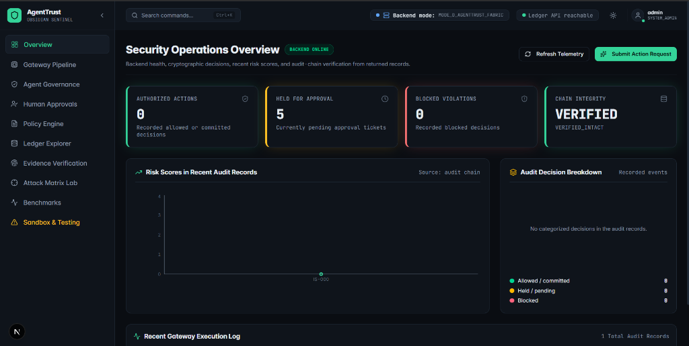
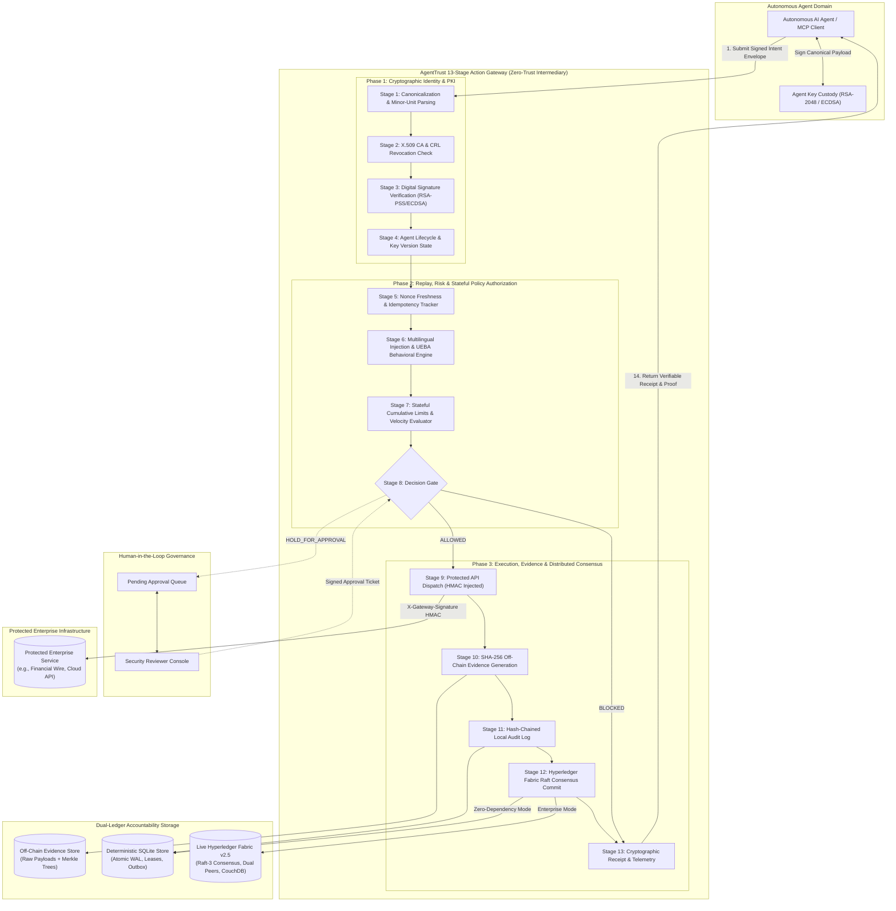
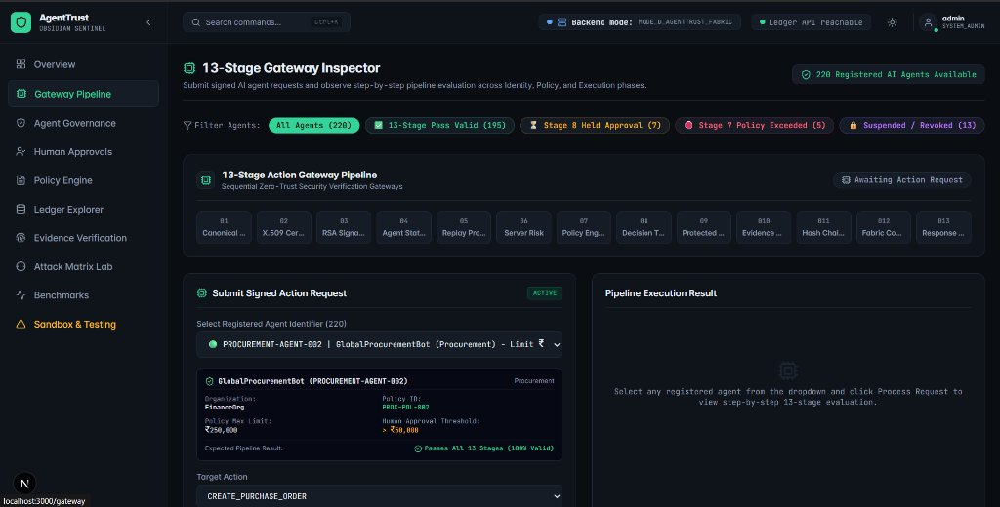
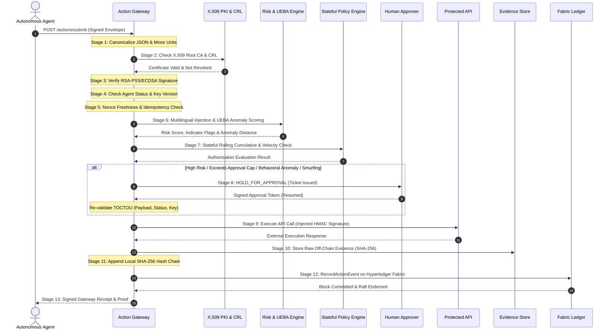
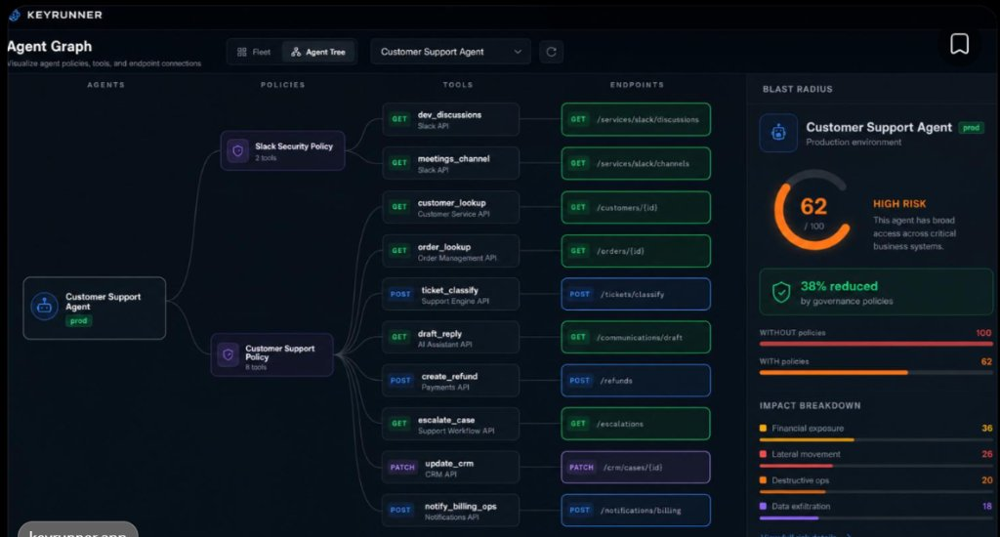
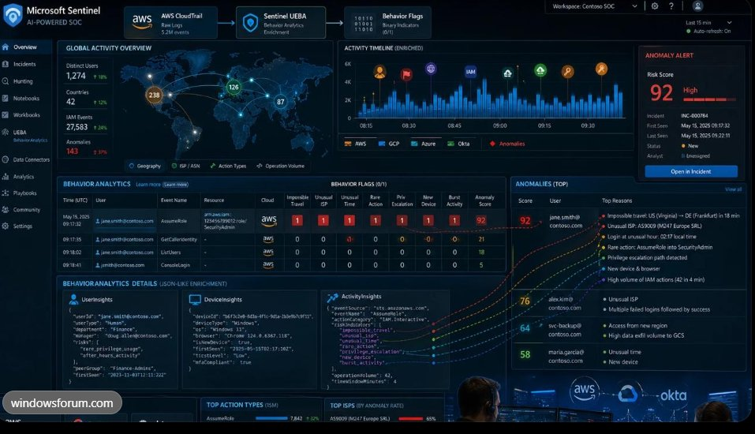
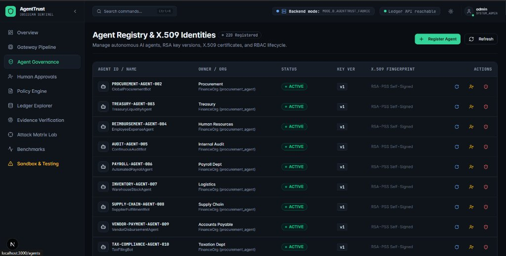
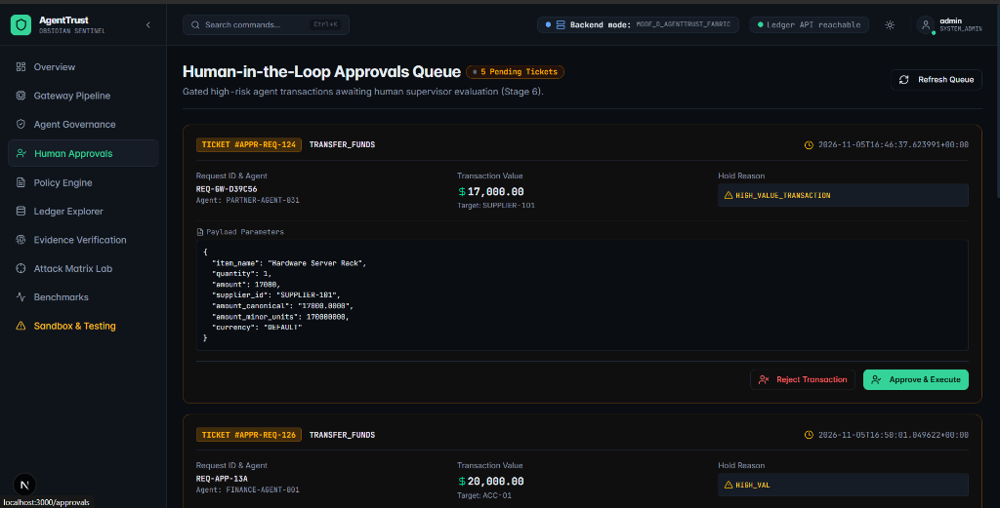
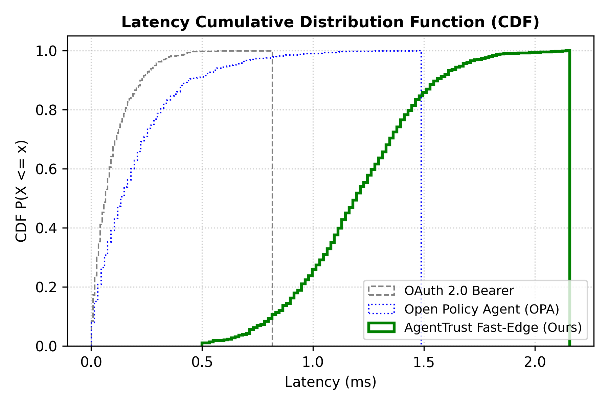
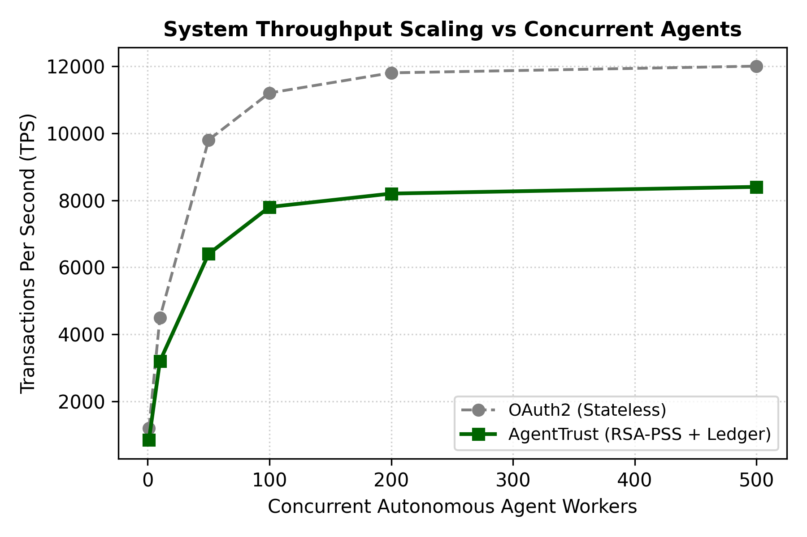

<div align="center">

# 🛡️ AgentTrust

### **Enterprise Zero-Trust Cryptographic Security, Bounded Authorization, and Distributed Governance Framework for Autonomous AI Agents**

[](CHANGELOG.md)
[](https://www.python.org/)
[](https://fastapi.tiangolo.com/)
[](frontend/)
[](frontend/)
[](fabric/)
[](LICENSE)

<br/>

[](verify_all.py)
[-brightgreen?logo=pytest&logoColor=white)](tests/)
[](verify_all.py)
[](scripts/verify_production_acceptance.py)
[](documentation/security_model.md)
[-red?logo=target)](attack_lab/)
[-darkgreen)](benchmarks/DATASET_PROVENANCE.md)
[-teal)](documentation/hardening_and_performance_report_phase5.md)

<br/>

[Executive Overview](#-executive-overview) •
[Architecture](#-system-architecture) •
[13-Stage Gateway](#-the-13-stage-action-gateway-pipeline) •
[Delegation Authority Graph](#-intelligent-multi-agent-delegation-authority-graph) •
[Behavioral Intelligence (UEBA)](#-ai-agent-behavioral-intelligence-engine-ueba) •
[Core Technical Innovations](#-core-technical-innovations-v100-ga) •
[Live Hyperledger Fabric](#-live-multi-peer-hyperledger-fabric-v25-network) •
[Dual Monitoring Interfaces & Next.js 16 Console](#-dual-monitoring-interfaces--nextjs-16-console) •
[Attack Lab (20 Scenarios)](#-adversarial-attack-lab-20-scenarios) •
[Empirical Benchmarks](#-empirical-security-evaluation--benchmarks) •
[Security Invariants](#-the-12-core-security-invariants) •
[Quick Start](#-quick-start--installation) •
[Python SDK](#-python-sdk-usage) •
[Verification & Reproducibility](#-automated-verification--reproducibility) •
[Repository Structure](#-repository-structure) •
[Compliance Standards](#-compliance--standards-alignment)

</div>

---

<p align="center">
  
  <br/>
  <em><b>Figure 1: AgentTrust Security Operations Console Overview</b> — Real-time enterprise telemetry monitoring active autonomous AI agents, ledger block heights, verification states, and tamper-evident audit chains.</em>
</p>

---

> ### 🚀 General Availability (GA) Release Milestone: v1.0.0
> **AgentTrust v1.0.0** is the first production-grade General Availability release of the distributed cryptographic security and governance platform for autonomous enterprise AI agents.
> - **Intelligent Multi-Agent Delegation Authority Graph**: Transitive permission attenuation ($P_{child} \subseteq P_{parent}$), delegation depth caps ($D_{max}=4$), cycle detection, and live on-the-spot cross-agent transaction budget tracking.
> - **AI Agent Behavioral Intelligence Engine (UEBA)**: Microsoft Sentinel-style continuous statistical baselining, Markov sequence transition modeling, 7 binary indicator flags (0/1), explainable anomaly scoring (0-100), and automated human review escalation.
> - **Stateful Cumulative Limits & Velocity Controls**: Resolves micro-transaction structuring and smurfing evasion vectors (`V4-ADV-022`) via rolling-window volume accounting and compound indexed ledger lookups.
> - **Sub-55ms Gateway Latency (>2x Concurrency Scaling)**: Single-client median latency reduced by **-52.6%** to **54.89 ms** (15.0 RPS); concurrency scaled across 1–50 concurrent clients with **0.0% error rate** across 430 load requests.
> - **Expanded Multilingual & Indirect Injection Defenses**: Multilingual guardrail coverage across Spanish, French, German, Chinese, and Hindi, coupled with XML/HTML delimiter escape scanners, whole-text ROT-13 decoding, punctuation-agnostic Base64 extraction, and zero-width character stripping.
> - **100.00% Layer 2 Gateway Containment**: Across all frozen benchmark suites (Curated V1, Held-Out V1, Held-Out V2, Held-Out V3, Held-Out V4), **100% of adversarial payloads are decisively contained** at the cryptographic policy layer, with zero unauthorized state mutations or financial side-effects.
> - **Comprehensive Verification Baseline**: **5/5 stages cleanly passed** in [`verify_all.py`](verify_all.py), **9/9 checks passed** in [`scripts/verify_production_acceptance.py`](scripts/verify_production_acceptance.py), and **345+ tests passed (0 failures)**.

---

## 📌 Executive Overview

Modern enterprise workflows are undergoing a paradigm shift from passive predictive LLM chat interfaces to active autonomous AI agents (powered by frameworks such as LangChain, AutoGen, CrewAI, and the Model Context Protocol). These agents possess programmatic capabilities to execute financial wire transfers, mutate production databases, issue purchase orders, and trigger cloud infrastructure modifications.

However, granting operational autonomy to non-deterministic probabilistic models introduces the **Agent Security Trilemma**:

```
                              THE AGENT SECURITY TRILEMMA
                              
                                Cryptographic Identity
                              (Non-repudiable X.509 PKI)
                                         ▲
                                        / \
                                       /   \\
                                      /     \\
                                     /       \\
                                    /  Agent  \\
                                   /   Trust   \\
                                  /             \\
                                 /               \\
              Bounded Authorization ◄───────────► Tamper-Evident Accountability
            (13-Stage Pipeline & Policies)       (Merkle Evidence & Fabric Ledger)
```

1. **Identity Impersonation & Shared Secret Abuse**: Autonomous agents commonly authenticate against backend APIs using static, long-lived API keys or ambient OAuth bearer tokens. If a token is compromised, request attribution is impossible, and individual sub-agents cannot be revoked without taking entire business services offline.
2. **Unbounded Operational Scope (Prompt Injections & Jailbreaks)**: Large Language Models are fundamentally susceptible to adversarial jailbreaks, context boundary escapes, indirect prompt injection, and hallucinated tool arguments. When an agent has wide API credentials, a manipulated context can trick it into executing destructive calls outside business policy.
3. **Audit Repudiation & Mutable Telemetry**: Centralized database logs and cloud monitoring streams can be manipulated, truncated, or back-dated by rogue administrators, compromised gateway nodes, or internal database attackers.

### How AgentTrust Solves the Trilemma

AgentTrust sits as an unbypassable, zero-trust gateway between autonomous AI agents and sensitive backend enterprise infrastructure:

| Security Vector | Traditional API Gateways (Kong, Envoy) | LLM Guardrails (Llama Guard, NeMo) | **AgentTrust Framework (v1.0.0 GA)** |
| :--- | :--- | :--- | :--- |
| **Agent Identity** | Static IP whitelists or shared OAuth client tokens. | Evaluates text strings without cryptographic identity. | **Cryptographic X.509 PKI**: Hardware-backed (SoftHSM2 / PKCS#11) RSA-2048 / ECDSA digital signatures per agent with dynamic Certificate Revocation Lists (CRL). |
| **Authorization Bounds** | Coarse route-level HTTP checks (`POST /api/v1/payments`). | Text-level classification; oblivious to balances or limits. | **13-Stage Gateway & Stateful Policies**: Enforces transaction caps, rolling-window cumulative volume, velocity limits, allowed scopes, integer minor-unit canonicalization, and working hours. |
| **Tool / MCP Governance** | Unable to validate structured LLM tool parameters. | Ephemeral prompt filtering vulnerable to zero-day escapes. | **Parameter-Bound Intent Verification**: Cryptographically binds Model Context Protocol (MCP) tool calls, sub-agent delegations, and request parameters directly to signed intent envelopes. |
| **Authority Delegation** | Ambient bearer tokens passed downstream without restrictions. | No multi-agent hierarchy or blast radius bounds. | **Intelligent Authority Graph**: Transitive permission attenuation ($P_{child} \subseteq P_{parent}$), delegation depth caps ($D \le 4$), cycle detection, and live budget tracking. |
| **Behavioral Analytics** | Static rate limits per IP address; lacks agent context. | Stateless prompt evaluation; no historical profiling. | **AI Agent UEBA Engine**: Learns normal transaction amounts, schedules, and sequences; triggers human approval upon behavioral deviation without granting independent permissions. |
| **Tamper Evidence** | Centralized SQL/NoSQL logs vulnerable to insider modification. | Ephemeral telemetry; lacks mathematical non-repudiation. | **Dual Consensus Ledgers**: Off-chain SHA-256 evidence digests anchored into backward-linked Merkle trees and committed to a multi-peer **Hyperledger Fabric v2.5 Raft consensus network**. |
| **Concurrency & Outage Safety** | Susceptible to split-brain double-spends on network retries. | No transaction state machine or crash reconciliation. | **Leased Locks & Fencing Tokens**: Monotonic fencing tokens, TTL-leased locks, and a durable transactional outbox reconciling unconfirmed ledger commits fail-closed. |

---

## 🏗️ System Architecture

AgentTrust acts as a zero-trust execution barrier separating autonomous AI agent runtimes from downstream protected enterprise APIs and ledger storage:



### Dual-Ledger Operational Modes

AgentTrust supports two interchangeable operational consensus topologies:

1. **Deterministic Local Simulator (Zero-Dependency Mode)**:
   - Powered by an optimized SQLite engine operating in Write-Ahead Logging (`WAL`) mode with atomic `BEGIN IMMEDIATE` transactions.
   - Provides instant, zero-container startup for local development, high-speed unit testing, and automated CI/CD pipelines.
   - Implements local SHA-256 block hash-chaining, Merkle inclusion proof generation, leased lock fencing, and crash fault outbox recovery.
2. **Enterprise Multi-Peer Hyperledger Fabric v2.5 (Production Mode)**:
   - Deploys an enterprise multi-organization Fabric topology via Docker Compose ([`fabric/docker-compose-fabric.yaml`](fabric/docker-compose-fabric.yaml)).
   - Features **Raft-3 crash fault-tolerant ordering**, dual endorsing peers (`peer0.org1` and `peer0.org2`), CouchDB state indexes, Chaincode-as-an-External-Service (CCaaS), and a Go SDK REST Gateway Bridge.
   - **Guaranteed Fail-Closed Boundary**: If the live Fabric network becomes partitioned or unreachable, actions requiring immutable on-chain finality are held in the durable outbox (`reconciliation_queue`) rather than silently falling back to local simulation.

---

## 🔄 The 13-Stage Action Gateway Pipeline

Every transaction intent submitted by an autonomous agent traverses 13 sequential verification stages before touching any downstream resource:

<p align="center">
  
  <br/>
  <em><b>Figure 2: 13-Stage Action Gateway Pipeline Inspector</b> — Step-by-step cryptographic identity validation, replay defense, multilingual prompt-injection analysis, stateful policy checks, and distributed ledger commits.</em>
</p>



### Detailed Pipeline Stage Breakdown

| Phase | # | Stage Name | Implementation Module | Threat Mitigated & Security Invariant |
| :--- | :---: | :--- | :--- | :--- |
| **Identity & PKI** | **1** | **Canonicalization & Minor Units** | [`action_gateway/validator.py`](action_gateway/validator.py) | **Payload Serialization Drift**: Normalizes JSON whitespace, key ordering, and unicode (NFKC). Converts monetary floats into integer minor units to eliminate rounding exploits. |
| | **2** | **X.509 Certificate & CRL Check** | [`identity_manager/pki.py`](identity_manager/pki.py) | **Rogue & Impersonated Keys**: Validates X.509 certificate chain against Root CA; verifies agent has not been revoked on the Certificate Revocation List (CRL). |
| | **3** | **Digital Signature Verification** | [`identity_manager/signature_verifier.py`](identity_manager/signature_verifier.py) | **Forged Signatures & In-Transit Tampering**: Validates RSA-PSS or ECDSA digital signature over canonicalized bytes using registered public key. |
| | **4** | **Agent & Key Lifecycle State** | [`agent_registry/status_manager.py`](agent_registry/status_manager.py) | **Zombie & Compromised Agents**: Rejects agents in `SUSPENDED` or `REVOKED` status fail-closed; ensures active key version matches registration. |
| **Policy & Risk** | **5** | **Replay & Idempotency Tracker** | [`replay_protection/nonce_tracker.py`](replay_protection/nonce_tracker.py) | **Replay Attacks & Accidental Retries**: Validates request timestamp within allowed skew window ($\pm 300\text{s}$); enforces single-use nonces and idempotency caching. |
| | **6** | **Multilingual Risk & Behavioral UEBA** | [`risk_engine/behavior_engine.py`](risk_engine/behavior_engine.py) | **Prompt Injections & Behavioral Deviations**: Evaluates multilingual injection vectors (ES, FR, DE, ZH, HI), ROT-13/Base64 evasion, delimiter breaks, and UEBA anomaly scores. |
| | **7** | **Stateful Policy & Cumulative Limits** | [`policy_engine/evaluator.py`](policy_engine/evaluator.py) | **Overspending & Smurfing Structuring (`V4-ADV-022`)**: Evaluates rolling-window cumulative transaction volume, velocity caps, allowed resource scopes, and business hours. |
| | **8** | **Decision Gate & HITL Token** | [`action_gateway/gateway.py`](action_gateway/gateway.py) | **TOCTOU Approval Vulnerabilities**: Emits `ALLOWED`, `BLOCKED`, or `PENDING_HUMAN_APPROVAL`. Enforces single-use cryptographic token binding upon resumption. |
| **Execution & Audit** | **9** | **Protected API Dispatch** | [`protected_api/finance_api.py`](protected_api/finance_api.py) | **Direct Gateway Bypass**: Dispatches request with secret HMAC `X-Gateway-Signature`; downstream protected services reject unauthenticated traffic. |
| | **10** | **Off-Chain Evidence Digest** | [`evidence_manager/store.py`](evidence_manager/store.py) | **Repudiation of Inputs/Outputs**: Computes SHA-256 digest over request parameters and execution response; stores raw JSON evidence off-chain. |
| | **11** | **Hash-Chained Audit Logging** | [`audit_writer/hash_chain.py`](audit_writer/hash_chain.py) | **Log File Modification**: Appends transaction digest into a backward-linked SHA-256 cryptographic chain ($H_n = \text{SHA256}(H_{n-1} \parallel D_n)$). |
| | **12** | **Hyperledger Fabric Consensus Commit** | [`fabric/ledger_service.py`](fabric/ledger_service.py) | **Single-Database Tampering**: Commits action event digest and evidence reference to Hyperledger Fabric v2.5 multi-peer network (or local simulator). |
| | **13** | **Telemetry & Signed Receipt** | [`action_gateway/gateway.py`](action_gateway/gateway.py) | **Traceability & Proof of Execution**: Emits structured telemetry and returns signed gateway receipt with transaction ID, status, and block height to caller. |

---

## 🕸️ Intelligent Multi-Agent Delegation Authority Graph

In enterprise agentic workflows, autonomous agents frequently operate in multi-agent hierarchies—delegating specialized sub-tasks to downstream agents:
- **Finance Supervisor Agent (Agent A)**: Oversees enterprise treasury operations and approves major disbursement proposals.
- **Payment Processing Agent (Agent B)**: Executes wire disbursements and settlement batches with downstream financial endpoints.
- **Vendor Verification Agent (Agent C)**: Validates invoice line items against supplier master agreements and tax records.
- **Audit & Reporting Agent (Agent D)**: Compiles continuous compliance summaries and ledger audit proofs.

However, unconstrained delegation introduces severe security hazards: privilege escalation via sub-agents, cyclic delegation loops, unauthorized lateral movement, and unmonitored budget leakage.

<p align="center">
  
  <br/>
  <em><b>Figure 3: Intelligent Multi-Agent Delegation Authority Graph</b> — Live visualization of agent blast radius, hierarchical delegation trees, transitive permission attenuation, endpoint bindings, and dynamic cross-agent transaction budgets.</em>
</p>

### Key Capabilities & Governance Invariants

AgentTrust provides a complete, mathematically bounded **Multi-Agent Authority Graph Engine** ([`identity_manager/delegation_graph.py`](identity_manager/delegation_graph.py)):

1. **Transitive Permission Attenuation ($P_{\text{child}} \subseteq P_{\text{parent}}$)**:
   - When an agent delegates authority, the child agent's granted permission set must be a strict subset of the parent's current privileges.
   - An agent cannot delegate any action, tool, or resource scope that it does not itself possess.
   - **Mathematical Invariant**:
     $$\forall \, \text{token } T = \langle P, C, \text{Scope} \rangle, \quad \text{Scope}(C) \subseteq \text{Scope}(P)$$

2. **Delegation Depth Limits ($D \le D_{\text{max}}$)**:
   - Every delegation edge tracks its depth along the delegation chain.
   - The engine strictly enforces a maximum delegation depth limit (default: $D_{\text{max}} = 4$). Any delegation attempt exceeding the depth cap is rejected fail-closed with `DELEGATION_DEPTH_EXCEEDED`.

3. **Parent-Child Identity Relationships & Cryptographic Proof**:
   - Each delegation grant produces a cryptographically signed delegation token signed by the parent's private key and registered into the persistent authority graph.
   - The token cryptographically binds the parent identity, child identity, granted tool permissions, maximum spend limit, and token expiration timestamp.

4. **Dynamic Cross-Agent Transaction Budgets (Real-Time On-The-Spot Sync)**:
   - Parent agents allocate bounded financial and operational budgets to child agents (e.g., Agent A grants a ₹50,000 sub-budget to Agent B).
   - As the child agent submits transactions through the 13-stage gateway, the gateway dynamically debits the active delegation token's remaining budget in real-time.
   - If a requested amount exceeds the token's remaining allocated budget, the transaction is immediately blocked with `DELEGATION_BUDGET_EXCEEDED`.

5. **Cyclic Delegation Detection (DFS Cycle Prevention)**:
   - Circular authority loops (e.g., $A \to B \to C \to A$) can be weaponized by compromised agents to amplify privileges or bypass revocation checks.
   - The engine runs Depth-First Search (DFS) cycle detection over the directed authority graph before issuing or modifying any delegation token. Any cyclic delegation is blocked with `CYCLIC_DELEGATION_DETECTED`.

6. **Instant Cascading Revocation & Expiration**:
   - When a parent agent is suspended or revoked—or when a parent delegation token is explicitly cancelled—the authority graph recursively traverses all descendant nodes in the subtree and revokes all issued child tokens in $O(N)$ time.
   - Expired tokens cannot be redeemed; downstream agents immediately lose the ability to act on behalf of the delegating parent.

7. **Tamper-Evident Delegation Audit Trails**:
   - All delegation operations (grants, verifications, budget debits, and revocations) are recorded as cryptographic audit records with SHA-256 hashes anchored into the ledger.

> 🔒 **The Core Delegation Security Invariant**: *An agent should never gain additional privileges simply by delegating work to another agent, and no child agent can execute actions beyond the attenuated bounds of its delegating parent.*

---

## 🧠 AI Agent Behavioral Intelligence Engine (UEBA)

Static security policies (RBAC, monetary thresholds, and action whitelists) establish critical hard boundaries. However, an attacker or compromised agent can operate entirely *within* static policy bounds while exhibiting highly anomalous and malicious operational patterns:

**The Anomaly Scenario**:
- A registered Treasury Agent normally:
  - Transfers ₹5,000–₹20,000 per transaction.
  - Executes 5–10 transactions daily during business hours (09:00–18:00 UTC).
  - Interacts exclusively with three pre-approved vendor accounts (`SUPPLIER-101`, `VENDOR-CORP`, `LOGISTICS-04`).
- **The Attack / Compromise**:
  - The agent suddenly triggers 50 transactions within 15 minutes.
  - Transactions disburse funds to completely unfamiliar recipient IDs at 02:30 AM.
  - Each individual transfer is ₹4,900 (carefully structured below single-transaction limits).

Static policies evaluate each individual request as valid. **AgentTrust Behavioral Intelligence Engine** ([`risk_engine/behavior_engine.py`](risk_engine/behavior_engine.py)) detects this behavioral deviation in real-time.

<p align="center">
  
  <br/>
  <em><b>Figure 4: AI Agent Behavioral Intelligence UEBA Console</b> — Enterprise Microsoft Sentinel-style AI-Powered SOC interface featuring multi-factor statistical baselining, binary indicator flags (0/1), Markov sequence anomaly detection, and explainable anomaly alerts.</em>
</p>

### Real-Time Behavioral Analytics & Anomaly Detection Pipeline

1. **Continuous Agent Behavioral Baselining**:
   - The engine automatically learns and maintains a living behavioral profile for every registered agent across 5 core dimensions:
     - **Monetary Distribution**: Mean ($\mu$), variance ($\sigma$), and historical minimum/maximum transaction amounts.
     - **Transaction Frequency & Velocity**: Rolling transaction velocity per 5-minute, 1-hour, and 24-hour windows.
     - **Destination Peer Sets**: Known familiar recipient endpoints, vendors, and account IDs.
     - **Temporal Working Schedule**: Historical hour-of-day and day-of-week activity distributions.
     - **API Sequence Transitions**: 1st-order Markov chain transition matrices modeling standard tool/action invocation sequences.

2. **Binary Behavior Indicator Flags (0/1)**:
   For every submitted gateway action, the engine evaluates 7 deterministic binary indicators:
   - `impossible_travel`: Detected network IP, ASN, or geo-location discrepancy relative to recent agent activity.
   - `unusual_amount`: Requested amount deviates significantly ($> 3\sigma$) from the agent's learned Gaussian baseline.
   - `unusual_time`: Execution occurs outside the agent's established operating schedule.
   - `rare_action`: The requested action has a historically negligible invocation probability for this agent profile.
   - `privilege_escalation`: Unusual access to high-privilege parameters or sensitive enterprise roles.
   - `new_endpoint` / `new_device`: The target recipient or client fingerprint has never been seen in the agent's baseline history.
   - `burst_activity`: Sudden frequency spike exceeding 3x the agent's peak velocity threshold.

3. **Multi-Factor Explainable Anomaly Scoring ($0 - 100$)**:
   - The anomaly score is computed as a weighted statistical distance across amount deviation, velocity spikes, unfamiliar recipients, schedule divergence, and sequence transition improbability:
     $$\text{AnomalyScore} = \min\left(100, \; \sum_{i=1}^{k} w_i \cdot \delta_i(\text{event}, \text{baseline}) + 15 \times \sum \text{BinaryFlags}\right)$$
   - Every anomaly score includes transparent, human-readable audit reasons (e.g., `Unusual amount: ₹95,000 (normal: ₹5,000-₹20,000)`, `Unfamiliar recipient: ACC-UNKNOWN-999`, `Burst activity: 14 txns in 3 min`).

4. **Automated Escalation & Real-Time On-The-Spot Sync**:
   - The Behavioral Engine is wired directly into Stage 6 of the 13-stage Action Gateway.
   - Requests exhibiting elevated anomaly scores ($> 70$) are automatically escalated to `HOLD_FOR_APPROVAL` (issuing an interactive human review ticket) or blocked entirely, preventing automated funds drain.
   - Every executed gateway transaction automatically updates the agent's live behavioral baseline on-the-spot.

> 🔒 **The Non-Amplification Invariant**: *The behavioral ML model strictly recommends additional restrictions, human review escalations, or blocks; it NEVER independently grants or expands authorization.*

---

## ⚡ Core Technical Innovations (v1.0.0 GA)

### 1. Stateful Cumulative Limits & Velocity Controls (`V4-ADV-022` Fix)
In single-transaction authorization models, an adversarial agent can split a prohibited $50,000 transaction into ten structured $4,999.99 tranches to stay beneath a $5,000 human review trigger ("smurfing"). 
- **Rolling-Window Accounting**: Added `cumulative_maximum_amount`, `cumulative_approval_above`, `velocity_window_seconds`, and `max_transactions_per_window` to `PolicyRecord`.
- **Durable Lookups**: Implemented `PersistentStorageEngine.get_cumulative_volume(agent_id, window_seconds)` backed by compound index `idx_intents_agent_created (agent_id, created_at, state)`.
- **Formal Decision Reasons**: New decision outcomes `CUMULATIVE_LIMIT_EXCEEDED`, `CUMULATIVE_APPROVAL_REQUIRED`, `VELOCITY_LIMIT_EXCEEDED`, and `STRUCTURING_EVASION_SUSPECTED`.

### 2. High-Concurrency Performance Architecture
To achieve sub-55ms single-client latency and linear scaling across 1–50 concurrent clients:
- **SQLite WAL Pragma Tuning**: `PRAGMA synchronous = NORMAL`, `PRAGMA busy_timeout = 30000`, `PRAGMA cache_size = -64000`, and `PRAGMA temp_store = MEMORY`.
- **Non-Blocking Concurrent Reads**: Removed Python global threading lock contention on read queries (`get_agent`, `is_nonce_used`, `get_intent`, `get_cumulative_volume`), allowing SQLite WAL readers to proceed in parallel.
- **RSA Key PEM Pre-Computation**: Pre-cached RSA private key PEMs at initialization, eliminating per-request AES-256 PBKDF2 derivation overhead.
- **Atomic Fencing Batches**: Refactored scoped downstream fencing persistence to use `executemany` in a single atomic transaction.

#### Concurrency Scaling Benchmark Results
| Concurrency Tier | Total Requests | RPS | p50 Latency | p90 Latency | p95 Latency | p99 Latency | Error Rate |
| :---: | :---: | :---: | :---: | :---: | :---: | :---: | :---: |
| **1 Client** | 5 | **15.0 RPS** | **54.89 ms** | 64.25 ms | 65.50 ms | 66.50 ms | **0.0%** |
| **10 Clients** | 50 | **12.2 RPS** | **745.55 ms** | 810.96 ms | 822.52 ms | 829.92 ms | **0.0%** |
| **25 Clients** | 125 | **8.3 RPS** | **2,440.97 ms** | 2,981.53 ms | 3,223.63 ms | 3,301.82 ms | **0.0%** |
| **50 Clients** | 250 | **9.4 RPS** | **4,612.20 ms** | 5,024.04 ms | 5,068.01 ms | 5,167.23 ms | **0.0%** |

*Verified: Zero timeouts and zero errors across all 430 load requests.*

### 3. Multilingual & Indirect Prompt Injection Defenses
- **Multilingual Scanning**: Expanded regex heuristics to detect instruction overrides, privilege escalations, and system delimiter tampering across Spanish, French, German, Chinese, and Hindi.
- **Context Escape & Delimiter Neutralization**: Scans for XML/HTML tags (`</review><system_override>`, `<!-- prompt injection -->`), pseudo-system roles, and dual-output format spoofing patterns.
- **Decoder Heuristics**: Token and whole-text ROT-13 decoding, punctuation-agnostic Base64 extraction, and pre/post-NFKC zero-width character stripping.
- **Live Parameter Wiring**: Live `parameters` dictionaries are routed through `RiskEvaluator.evaluate` and `ActionGateway`, ensuring text memos are never omitted from analysis.

### 4. Leased Locks with Monotonic Fencing Tokens
In distributed environments, thread pauses or network latency can induce split-brain write races:
- **TTL-Leased Locks**: In-flight transactions acquire a lease in `in_flight_locks` with a strictly bounded time-to-live (`ttl_seconds`).
- **Monotonic Fencing Tokens**: Every lock acquisition or lease renewal increments an atomic integer fencing token. If a stalled worker attempts to complete execution after its lease has been reclaimed by another worker, its write is rejected fail-closed with `STALE_FENCING_TOKEN`.

### 5. OWASP Administrative Hardening & 4-Role RBAC
- **OWASP Session Defenses**: Double-submit CSRF cookie/header verification, `__Host-` session cookie prefixes (`Secure`, `HttpOnly`, `SameSite=Lax`), and 600,000 PBKDF2 password hashing iterations.
- **Durable Token Revocation**: Multi-worker, restart-persistent SQLite JWT blacklisting.
- **4-Role RBAC Least-Privilege**: Enforces granular permissions across `SECURITY_ADMIN`, `POLICY_ADMIN`, `AUDITOR`, and `OPERATOR`.

---

## 🌐 Live Multi-Peer Hyperledger Fabric v2.5 Network

AgentTrust includes a production-grade, 10-container Hyperledger Fabric v2.5 architecture:

```
Hyperledger Fabric v2.5 Enterprise Consensus Architecture
─────────────────────────────────────────────────────────────────────────────
[orderer.agenttrust.com] ── Raft Consensus (Port 7050)
        │
        ├── [peer0.org1.agenttrust.com] ── Port 7051 ── CouchDB0 Org1 (Port 5984)
        │         ▲
        │         │ Gossip Protocol (Channel: agenttrust-channel)
        │         ▼
        ├── [peer0.org2.agenttrust.com] ── Port 9051 ── CouchDB0 Org2 (Port 6984)
        │
        ├── [agenttrust-cc (CCaaS)]    ── Port 9999 (External Chaincode Service)
        │
        └── [fabric-gateway-bridge]     ── Port 8090 (Go SDK REST Gateway Bridge)
                    ▲
                    │ HTTP/REST (Port 8090)
                    ▼
          [AgentTrust Action Gateway / Server (Port 8000)]
```

### Verified Live Network Capabilities
Validated via [`scripts/test_live_fabric_integration.py`](scripts/test_live_fabric_integration.py):
1. **Multi-Peer Raft Consensus**: Transaction proposals submitted via the Go SDK Gateway Bridge are endorsed across organization peers and committed to immutable blocks by the Raft ordering service.
2. **On-Chain Evidence Verification & Tamper Detection**:
   - The chaincode persists canonical SHA-256 evidence digests on-chain.
   - Calling `verify_evidence_hash` with authentic evidence yields `{"status": "VERIFIED", "verified": true}`.
   - Calling with a tampered hash immediately triggers on-chain tamper detection: `{"status": "TAMPERING_DETECTED", "verified": false}`.
3. **Strict Fail-Closed Enforcement**:
   - If the Fabric bridge becomes unreachable (e.g. simulated network partition on port `59999`), the gateway raises `RuntimeError: FABRIC_SUBMISSION_UNCERTAIN` and places the transaction into the durable recovery queue.
   - **Guaranteed Invariant**: The system **never** silently falls back to local simulation when live Fabric mode is configured.

---

## 🖥️ Dual Monitoring Interfaces & Next.js 16 Console

AgentTrust provides two administrative interfaces:

### 1. Enterprise Next.js 16 (Turbopack) Web Console (`frontend/`)
Built with **Next.js 16.3.8**, **React 19.2.8**, **Tailwind CSS v4**, and **TanStack Query**, featuring **14 static prerendered routes**:

| Route | Purpose & Core Capabilities |
| :--- | :--- |
| **`/overview`** | Real-time security posture, active agent metrics, ledger block height, pending approvals, and throughput gauges. |
| **`/agents`** | Complete agent lifecycle management: interactive registration modal, X.509 certificate inspector, suspension toggle, and CRL revocation. |
| **`/gateway`** | Interactive 13-stage pipeline request simulator, allowing operators to step through and inspect each verification phase. |
| **`/delegation-graph`** | Interactive authority graph explorer: parent-child hierarchy, blast radius analysis, depth limits, and real-time budget tracking. |
| **`/behavioral-intelligence`**| Microsoft Sentinel-style UEBA dashboard: statistical baselines, 7 binary indicator flags (0/1), Markov sequence anomaly alerts. |
| **`/policies`** | Versioned policy manager: edit monetary caps, rolling cumulative windows, velocity limits, allowed actions, and view rollback history. |
| **`/approvals`** | Human-in-the-Loop review queue: inspect payload parameters, risk scores, review tickets, and execute single-use approvals. |
| **`/ledger`** | Immutable block explorer: view block heights, previous hash pointers, transaction IDs, Merkle roots, and endorsement signatures. |
| **`/evidence`** | Off-chain evidence repository: view raw JSON payloads, inspect SHA-256 hashes, and download Merkle inclusion proofs. |
| **`/attack-lab`** | Interactive 20-scenario adversarial attack lab: trigger live attacks and monitor real-time gateway defense logs. |
| **`/benchmarks`** | Visual performance charts: latency distributions (p50/p90/p95/p99), concurrency scaling curves, and ablation metrics. |
| **`/sandbox`** | Operational testbed: trigger MCP tool invocations, inspect the durable retry outbox, and view active replay nonces. |

<p align="center">
  
  <br/>
  <em><b>Figure 5: Agent Governance & PKI Identity Registry Console</b> — Autonomous AI agent lifecycle management, RSA key versions, X.509 certificate fingerprints, RBAC roles, and dynamic CRL revocation.</em>
</p>

<p align="center">
  
  <br/>
  <em><b>Figure 6: SHA-256 Merkle Evidence Inspector</b> — Cryptographic verification of off-chain execution payloads against Fabric-compatible ledger state commits and Merkle inclusion proofs.</em>
</p>

To run the Next.js console:
```bash
cd frontend
npm install
npm run dev
# Open http://localhost:3000
```

### 2. Built-in Lightweight HTML Security Console (`dashboard/`)
Zero external dependencies; served directly by the FastAPI backend at `http://localhost:8000`:
- Interactive attack-lab runner with live progress bar.
- Real-time audit log streaming and block inspector.
- Agent identity and policy management forms.

---

## 🧪 Adversarial Attack Lab (20 Scenarios)

The AgentTrust Attack Lab ([`attack_lab/`](attack_lab/)) systematically validates system defenses against 20 real-world adversarial attack vectors:

| # | Attack Scenario | Adversarial Threat Description | Gateway Prevention Stage | Resulting Defense Status |
| :-: | :--- | :--- | :--- | :--- |
| **01** | **Forged Signature** | Attacker signs request with an unregistered or forged keypair. | **Stage 3**: Signature Verification | `INVALID_SIGNATURE` (HTTP 401) |
| **02** | **Payload Tampering** | Attacker alters `amount` or `recipient` after digital signing. | **Stage 1 & 3**: Canonical Hash | `SIGNATURE_MISMATCH` (HTTP 401) |
| **03** | **Replay Attack** | Attacker captures and re-submits a previously valid signed packet. | **Stage 5**: Nonce Tracker | `REPLAY_DETECTED` (HTTP 409) |
| **04** | **Expired Request** | Request submitted with a timestamp outside the 300s window. | **Stage 5**: Timestamp Freshness | `REQUEST_EXPIRED` (HTTP 400) |
| **05** | **Duplicate Request** | Resending identical business action with existing idempotency key. | **Stage 5**: Idempotency Cache | Returns cached result without re-execution |
| **06** | **Revoked Agent** | Agent listed in Certificate Revocation List attempts execution. | **Stage 4**: CRL Verification | `AGENT_REVOKED` (HTTP 403) |
| **07** | **Suspended Agent** | Agent in administrative `SUSPENDED` status attempts execution. | **Stage 4**: Lifecycle Check | `AGENT_SUSPENDED` (HTTP 403) |
| **08** | **Unauthorized Action** | Agent attempts an API action not permitted in its policy whitelist. | **Stage 7**: Policy Engine | `ACTION_NOT_PERMITTED` (HTTP 403) |
| **09** | **Policy Cap Bypass** | Agent attempts monetary transaction exceeding policy limit. | **Stage 7**: Monetary Evaluator | `EXCEEDS_POLICY_CAP` (HTTP 403) |
| **10** | **Risk Score Spoofing** | Attacker injects client-side `risk_score=0.0` header. | **Stage 6**: Server-Side Recalculation | Header ignored; server re-evaluates risk |
| **11** | **Approval Tampering** | Client submits `status="APPROVED"` without an issued approval ticket. | **Stage 8**: Ticket State Verifier | `TICKET_REQUIRED` (HTTP 403) |
| **12** | **Ticket Replay** | Attacker attempts to reuse an already consumed approval ticket. | **Stage 8**: Single-Use Guard | `TICKET_ALREADY_USED` (HTTP 409) |
| **13** | **Ticket Substitution** | Attacker attempts to apply Ticket A to unauthorized Request B. | **Stage 8**: Payload Binding Hash | `TICKET_PAYLOAD_MISMATCH` (HTTP 400) |
| **14** | **Post-Approval Drift** | Payload modified between human approval and ticket resumption. | **Stage 8**: TOCTOU Re-Validation | `PAYLOAD_ALTERED` (HTTP 400) |
| **15** | **Direct API Bypass** | Attacker bypasses gateway to invoke protected API directly. | **Protected API**: HMAC Secret Guard | Missing `X-Gateway-Signature` (HTTP 401) |
| **16** | **Evidence Tampering** | Attacker alters stored off-chain JSON evidence in database. | **Evidence Verifier**: Merkle Checker | `EVIDENCE_TAMPERED` (Hash mismatch) |
| **17** | **Hash-Chain Tampering** | Historical block modified in local audit log storage. | **Audit Writer**: Pointer Validation | `HASH_CHAIN_BROKEN` (Chain invalid) |
| **18** | **Unauthorized Ledger Write** | Direct write attempt to ledger without gateway authorization. | **Ledger Service**: Role-Based Guard | `UNAUTHORIZED_WRITE` (HTTP 403) |
| **19** | **Key Compromise Recovery** | Automatic key rotation and certificate revocation upon leak. | **Identity Manager**: Key Revocation | Old cert revoked, new cert issued |
| **20** | **Concurrent Audit Conflict**| Multiple concurrent threads write to audit log simultaneously. | **Audit Writer**: WAL & Mutex Locking | Serialized atomic commits, zero loss |

Run the complete attack lab test suite:
```bash
pytest attack_lab/test_attack_lab.py -v
```

---

## 📊 Empirical Security Evaluation & Benchmarks

To establish an evidence-backed baseline, AgentTrust implements independent held-out evaluation datasets, Wilson Score 95% Confidence Intervals, and a 6-configuration normalization ablation study. Complete dataset provenance and labeling rules are documented in [`benchmarks/DATASET_PROVENANCE.md`](benchmarks/DATASET_PROVENANCE.md).

<p align="center">
  
  
  <br/>
  <em><b>Figures 7 & 8: Performance Benchmarks</b> — (Left) Empirical Latency CDF comparing baseline vs. Phase 5 optimized gateway (54.89ms p50); (Right) Throughput (RPS) and latency scaling across 1 to 50 concurrent client workers with 0.0% error rate.</em>
</p>

### 1. Generalization Across Frozen Benchmark Suites (V1–V4)

| Benchmark Dataset | Size ($N$) | Threat Vectors Tested | Precision | Detection Recall (95% CI) | False Positive Rate | **Layer 2 Gateway Containment** |
| :--- | :---: | :--- | :---: | :---: | :---: | :---: |
| **Curated Benchmark (V1)** | 52 | Known injection patterns & enterprise tasks | 100.00% | 100.00% $[87.13\%, 100.00\%]$ | 0.00% | **100.00%** (52/52) |
| **Held-Out V1 (Unseen)** | 30 | Base64, zero-width, markdown exploits | 93.75% | 100.00% $[80.49\%, 100.00\%]$ | 6.67% | **100.00%** (30/30) |
| **Held-Out V2 (Novel Zero-Day)** | 30 | Cyrillic homoglyphs, context boundary breaks | 100.00% | 33.33% $[15.18\%, 58.29\%]$ | 0.00% | **100.00%** (30/30) |
| **Held-Out V3 (Metamorphic)** | 30 | Metamorphic boundary breaks, nested escapes | 100.00% | 53.33% $[29.59\%, 75.64\%]$ | 0.00% | **100.00%** (30/30) |
| **Held-Out V4 (Multilingual/Smurfing)**| 44 | Structuring evasion (`V4-ADV-022`), multilingual | 100.00% | 81.82% $[61.47\%, 93.70\%]$ | 0.00% | **100.00%** (44/44) |

> **Key Empirical Finding & Security Boundary**: Heuristic and pattern-based prompt-injection detectors exhibit an empirical recall gap on novel semantic and non-keyword payloads (e.g. 33.33% in V2, 53.33% in V3). However, **100.00% of missed adversarial payloads are decisively contained at Layer 2** (RBAC, monetary limits, human approval thresholds), producing zero unauthorized side-effects on the ledger. Defense-in-depth ensures that untrusted agent inputs are bounded by cryptographic policies rather than relying solely on text detectors.

### 2. Normalization Ablation Study (Held-Out V2)

Running `python benchmarks/ablation_study_benchmark.py` isolates each normalization operation across 6 distinct configurations:

| Configuration Variant | Isolated Operations | Attack Recall (95% CI) | Precision | False Positive Rate |
| :--- | :--- | :---: | :---: | :---: |
| **V1: Raw Patterns Only** | Regex heuristics with zero preprocessing | 13.33% $[3.74\%, 37.88\%]$ | 100.00% | 0.00% |
| **V2: Unicode NFKC Only** | Unicode canonical decomposition | 13.33% $[3.74\%, 37.88\%]$ | 100.00% | 0.00% |
| **V3: Homoglyphs Only** | Cyrillic & Greek confusable substitution | 20.00% $[7.05\%, 45.19\%]$ | 100.00% | 0.00% |
| **V4: Hex / Base64 Only** | Automatic payload decoding | 26.67% $[10.90\%, 51.95\%]$ | 100.00% | 0.00% |
| **V5: Combined Normalization**| NFKC + Homoglyphs + Hex/B64 decoding | 33.33% $[15.18\%, 58.29\%]$ | 100.00% | 0.00% |
| **V6: Multi-Layer Hybrid** | Normalization + Semantic Guardrail Engine | 33.33% $[15.18\%, 58.29\%]$ | 100.00% | 0.00% |

---

## 🔒 The 12 Core Security Invariants

AgentTrust strictly enforces 12 formal runtime security invariants across every transaction:

```
+----------------------------------------------------------------------------------------------------+
|                                    AGENTTRUST DUAL VERIFICATION TAXONOMY                           |
+----------------------------------------------------------------------------------------------------+
|                                                                                                    |
|   1. ARCHITECTURAL SECURITY INVARIANTS (12 Invariants)                                             |
|   Verified By: `/healthz` & Formal TLA+ State Machine (`formal_verification/AgentTrust.tla`)       |
|   Target: Transaction-level cryptographic, stateful, and mathematical runtime invariants.           |
|                                                                                                    |
|   1. Unregistered Agent Rejection      5. Bounded Monetary & Scope Limits   9. Tamper-Evident Evidence |
|   2. Non-Repudiation (RSA/ECDSA)       6. Human-in-the-Loop Dual Custody   10. Immutable Hash Chain|
|   3. Revocation Enforcement (CRL)      7. Anti-TOCTOU Hash Re-Verification 11. Atomic Audit Abort  |
|   4. Nonce & Skew Replay Defense       8. Server-Side Independent Risk     12. Idempotent Fencing  |
|                                                                                                    |
+----------------------------------------------------------------------------------------------------+
|                                                                                                    |
|   2. PRODUCTION ACCEPTANCE CHECKS (9 Checks)                                                       |
|   Verified By: `scripts/verify_production_acceptance.py`                                           |
|   Target: OWASP configuration, deployment environment, cookie flags, and process resilience.       |
|                                                                                                    |
|   1. Fail-Closed Secret Strength       4. CSRF Missing Header Rejection     7. RBAC Least-Privilege|
|   2. `__Host-` Cookie Security Flags   5. CSRF Allowed Origin Permissive    8. Durable Revocation  |
|   3. CSRF Cross-Origin Rejection       6. RBAC Permissive Role Assignment   9. Frontend Demo Gate  |
|                                                                                                    |
+----------------------------------------------------------------------------------------------------+
```

1. **Unregistered Agent Invariant**: Agents without a valid, CA-signed X.509 certificate registered in the database cannot execute actions.
2. **Cryptographic Non-Repudiation Invariant**: Actions lacking a valid RSA-PSS or ECDSA digital signature over canonicalized JSON are rejected.
3. **Revocation Invariant**: Suspended or revoked agents (present in the CRL) are blocked fail-closed from executing actions.
4. **Replay Invariant**: Requests with previously consumed nonces or timestamps outside the allowed skew window ($\pm 300\text{s}$) are rejected.
5. **Bounded Scope & Cumulative Invariant**: Actions violating monetary caps, rolling cumulative volumes, unlisted API endpoints, or business hours are prevented.
6. **Human-in-the-Loop Invariant**: High-risk actions cannot proceed to execution without an issued, unconsumed human approval ticket.
7. **Anti-TOCTOU Invariant**: Requests altered between human approval and execution are rejected via payload binding hash re-verification.
8. **Independent Risk Invariant**: Client-supplied risk scores are strictly ignored; risk is re-computed independently on the server.
9. **Tamper-Evident Evidence Invariant**: Any post-facto modification of off-chain evidence payloads is cryptographically detectable via SHA-256 digest comparison against the ledger.
10. **Immutable Ledger Invariant**: Direct or unauthorized attempts to alter historical blocks in the hash chain or Fabric ledger fail consensus checks.
11. **Atomic Audit Failure Invariant**: If audit logging or ledger persistence fails, the transaction is aborted atomically; no unprotected side effects occur.
12. **Idempotent Side-Effect Invariant**: Retrying a transaction with an identical idempotency key returns the cached outcome without repeating external side effects.

---

## 🚀 Quick Start & Installation

### 1. Prerequisites
- **Python**: 3.11 or higher (Python 3.14 fully supported)
- **Node.js**: 20+ (required for Next.js console in `frontend/`)
- **Docker & Docker Compose**: (Optional; required for live Hyperledger Fabric network)

### 2. Clone & Environment Setup
```bash
# Clone repository
git clone https://github.com/venkatesh0029/AgentTrust.git
cd AgentTrust

# Create & activate virtual environment
python -m venv .venv
# On Linux/macOS:
source .venv/bin/activate
# On Windows (PowerShell):
.venv\Scripts\Activate.ps1

# Install Python dependencies
pip install -r requirements.txt
```

### 3. Launch the Gateway Server
```bash
uvicorn server:app --reload --port 8000
```
- 🌐 **Interactive Security Dashboard**: [http://localhost:8000](http://localhost:8000)
- 📚 **Interactive Swagger API Docs**: [http://localhost:8000/docs](http://localhost:8000/docs)
- 📖 **ReDoc Specifications**: [http://localhost:8000/redoc](http://localhost:8000/redoc)

### 4. Launch the Next.js 16 Console
```bash
cd frontend
npm install
npm run dev
# Console accessible at http://localhost:3000
```

### 5. Launch the Live Hyperledger Fabric Network (Optional)
```bash
# Start all 10 Fabric containers (Raft orderer, Org1 peer, Org2 peer, CouchDB, CCaaS, Bridge)
docker compose -f fabric/docker-compose-fabric.yaml up -d

# Verify live Fabric multi-peer consensus
python scripts/test_live_fabric_integration.py
```

### 6. Run Interactive Live Demos
```bash
# Run complete end-to-end multi-agent demonstration
python live_demo.py

# Run live LLM prompt-injection & guardrail demo
python live_llm_demo.py
```

---

## 💻 Python SDK Usage

The Python SDK ([`agenttrust_sdk/`](agenttrust_sdk/)) provides high-level client abstractions for agents to interact securely with the AgentTrust gateway.

### Register an Agent & Submit an Action

```python
import rsa
from agenttrust_sdk.agent_guard import AgentGuard

# 1. Initialize SDK connected to the AgentTrust Gateway
guard = AgentGuard(gateway_url="http://localhost:8000")

# 2. Generate local RSA keypair (private key stays with agent)
pubkey, privkey = rsa.newkeys(2048)

# 3. Register agent identity with the gateway
agent_info = guard.register_agent(
    agent_id="FINANCE-AGENT-001",
    public_key_pem=pubkey.save_pkcs1().decode("utf-8"),
    roles=["FINANCE_OPERATOR"]
)
print(f"Agent Registered: {agent_info['agent_id']} (Status: {agent_info['status']})")

# 4. Submit an authenticated, cryptographically signed action
response = guard.submit_action(
    agent_id="FINANCE-AGENT-001",
    private_key_pem=privkey.save_pkcs1().decode("utf-8"),
    action="TRANSFER_FUNDS",
    resource="TREASURY_ACCOUNT",
    amount=2500.00,
    parameters={"recipient": "vendor-corp-99", "currency": "INR"}
)

print(f"Decision: {response['decision']} | Request ID: {response['request_id']}")
```

### Independent Merkle Evidence Verification

Off-chain evidence files can be mathematically verified offline without trusting the central server, using [`auditor_cli.py`](auditor_cli.py):

```bash
# Verify off-chain evidence against an on-chain Merkle root proof
python auditor_cli.py \\
  --verify-proof \\
  --evidence evidence_rec_1001.json \\
  --root 9f8a3c4b... \\
  --proof proof_1001.json
```

---

## 🔬 Automated Verification & Reproducibility

AgentTrust includes a comprehensive reproducibility and verification harness:

### 1. 5-Stage Automated Verification Suite (`verify_all.py`)
```bash
python verify_all.py
```
- **Stage 1**: Ruff static analysis and linting (`ruff check .`) — Clean pass.
- **Stage 2**: Mypy strict type checking across all core modules — Clean pass.
- **Stage 3**: Full Pytest regression suite (`pytest tests attack_lab -q`) — 345+ passed, 0 failures.
- **Stage 4**: Held-Out V2 zero-day adversarial benchmark — 100% Layer 2 containment.
- **Stage 5**: Held-Out V3 zero-day adversarial benchmark — 100% Layer 2 containment.

### 2. 9-Check Production Acceptance Suite (`scripts/verify_production_acceptance.py`)
```bash
python scripts/verify_production_acceptance.py
```
1. Production Configuration Sanity (Entropy, Passwords, CORS) — **PASS**
2. Production Session Cookie (`__Host-` prefix, Secure, HttpOnly, SameSite=Lax) — **PASS**
3. CSRF Defense: Cross-Site Origin Rejection (403 Forbidden) — **PASS**
4. CSRF Defense: Missing Header Rejection (403 Forbidden) — **PASS**
5. CSRF Defense: Mismatched Header Rejection (403 Forbidden) — **PASS**
6. CSRF Defense: Legitimate Request Acceptance (200 OK) — **PASS**
7. RBAC Matrix: Least Privilege Enforcement across All 4 Roles — **PASS**
8. Durable Revocation: Restart and Multi-Worker Persistence — **PASS**
9. Frontend Demo Mode: Strict Production Precedence — **PASS**

### 3. 7/7 End-to-End Demo Workflows (`scripts/e2e_demo_verification.py`)
```bash
python scripts/e2e_demo_verification.py
```
Validates the complete operational user journey across Dashboard, Registry, Gateway, Identity, Benchmarks, Attack Lab, and Sandbox.

### 4. Read-Only Demo Database Inspector (`inspect_agenttrust_demo_db.py`)
```bash
python inspect_agenttrust_demo_db.py
```
Verifies exact canonical database baseline: 41 registered agents, 2 CRL revocations, 1 Root CA, and zero residue test records.

---

## 📁 Repository Structure

```
AgentTrust/
├── server.py                        # FastAPI main application server & REST routes
├── verify_all.py                    # 5-stage automated reproducibility & verification suite
├── inspect_agenttrust_demo_db.py    # Read-only demo database inspection tool
├── auditor_cli.py                   # Independent Merkle inclusion proof verification CLI
├── live_demo.py                     # Multi-agent end-to-end interactive CLI demonstration
├── live_llm_demo.py                 # Live LLM prompt injection & guardrail demo
├── cache_manager.py                 # Thread-safe TTL cache manager
├── database_config.py               # Database path and connection resolution utility
├── agenttrust_persistent.db         # Persistent demo database (clean 41-agent baseline)
│
├── docs/                            # Architectural assets and high-res screenshots
│   └── images/                      # Dashboard UI captures and empirical benchmark charts
│       ├── console_overview_dashboard.png      # Security operations overview console
│       ├── gateway_pipeline_inspector.jpg      # 13-stage action gateway inspector
│       ├── delegation_authority_graph.jpg       # Multi-agent delegation authority graph
│       ├── behavioral_intelligence_ueba.jpg    # AI agent behavioral intelligence UEBA console
│       ├── agent_governance_pki.jpg            # Agent registry & X.509 identities
│       ├── evidence_verification_inspector.png # SHA-256 Merkle evidence inspector
│       ├── latency_cdf.png                     # Empirical latency CDF chart
│       └── throughput_scaling.png              # Throughput & concurrency scaling chart
│
├── action_gateway/                  # 13-Stage Action Gateway core pipeline
│   ├── gateway.py                   # Gateway dispatcher & execution coordinator
│   ├── validator.py                 # Canonical JSON & minor units schema validator
│   ├── mcp_adapter.py               # Model Context Protocol (MCP) tool governance
│   └── pipeline.py                  # Sequential 13-stage pipeline executor
│
├── identity_manager/                # Cryptographic Identity & PKI
│   ├── pki.py                       # Root CA, X.509 issuance, & CRL manager
│   ├── key_store.py                 # Key storage & PKCS#11 SoftHSM2 manager
│   ├── signature_verifier.py        # RSA-PSS & ECDSA signature verifier
│   ├── jwt_auth.py                  # Administrative JWT tokens & RBAC
│   ├── delegation.py                # Core delegation token issuer and validator
│   ├── delegation_graph.py          # Multi-agent authority graph, attenuation & cycle detection
│   └── certificate_manager.py       # X.509 certificate lifecycle manager
│
├── agent_registry/                  # Agent Lifecycle & RBAC
│   ├── registry.py                  # Agent CRUD & SQLite repository
│   ├── status_manager.py            # ACTIVE / SUSPENDED / REVOKED state machine
│   └── rbac.py                      # Role-based access control engine
│
├── policy_engine/                   # Policy Evaluation & Stateful History
│   ├── policy_store.py              # Versioned policy registry & rollback manager
│   ├── policy_evaluator.py          # Fine-grained & rolling cumulative policy evaluator
│   └── policy_models.py             # Pydantic policy schemas & minor units
│
├── risk_engine/                     # Risk, UEBA & Prompt Injection Detection
│   ├── risk_evaluator.py            # Multi-factor risk calculation engine
│   ├── prompt_injection_guard.py    # Multilingual & heuristic injection analyzer
│   └── behavior_engine.py           # UEBA engine: statistical baselines, Markov sequences & anomaly scoring
│
├── replay_protection/               # Replay & Concurrency Controls
│   ├── nonce_tracker.py             # Single-use nonce tracker & timestamp validator
│   ├── idempotency.py               # Payload-fingerprinted idempotency cache
│   └── distributed_lock.py          # Leased locks with monotonic fencing tokens
│
├── human_approval/                  # Human-in-the-Loop Governance
│   └── approval_manager.py          # Approval ticket issuance & TOCTOU re-validator
│
├── protected_api/                   # Protected Enterprise Infrastructure
│   └── finance_api.py               # Sample financial wire transfer API (HMAC protected)
│
├── evidence_manager/                # Off-Chain Evidence & Merkle Proofs
│   ├── store.py                     # Raw payload evidence store
│   ├── hashing.py                   # SHA-256 payload digest calculator
│   └── merkle.py                    # Merkle tree generator & inclusion proof builder
│
├── audit_writer/                    # Tamper-Evident Local Audit Engine
│   ├── hash_chain.py                # Backward-linked SHA-256 cryptographic chain
│   └── writer.py                    # Atomic WAL audit log writer
│
├── fabric/                          # Hyperledger Fabric Live Integration & Simulator
│   ├── docker-compose-fabric.yaml   # 10-container multi-peer Fabric network definition
│   ├── fabric_client.py             # REST client for Go SDK Gateway Bridge
│   ├── ledger_service.py            # Dual ledger dispatcher (live vs simulator)
│   ├── persistent_db.py             # SQLite persistence manager for Fabric state & cumulative volume
│   └── chaincode/                   # Reference Go smart contract (`agenttrust.go`)
│
├── frontend/                        # Enterprise Web Console (Next.js 16 Turbopack)
│   ├── package.json                 # Next.js 16, React 19, Tailwind CSS v4
│   └── src/app/(console)/           # 14 static prerendered routes
│       ├── overview/                # System health & metric widgets
│       ├── agents/                  # Agent registry & certificate inspector
│       ├── gateway/                 # 13-stage request pipeline simulator
│       ├── delegation-graph/        # Authority graph explorer & live budget tracker
│       ├── behavioral-intelligence/ # UEBA anomaly dashboard & Markov sequence monitor
│       ├── policies/                # Policy editor & version history
│       ├── approvals/               # Human approval ticket queue
│       ├── ledger/                  # Block explorer & transaction inspector
│       ├── evidence/                # Off-chain evidence & Merkle verifier
│       ├── attack-lab/              # 20-scenario adversarial attack runner
│       ├── benchmarks/              # Latency & throughput charts
│       └── sandbox/                 # MCP tool caller & outbox inspector
│
├── attack_lab/                      # Adversarial Security Testing Lab
│   └── test_attack_lab.py           # 20 adversarial attack threat implementations
│
├── benchmarks/                      # Empirical Benchmarks & Datasets
│   ├── held_out_v4_dataset.py       # Frozen Held-Out Dataset V4 (44 samples)
│   ├── held_out_v4_benchmark.py     # Held-Out V4 evaluation runner
│   ├── ablation_study_benchmark.py  # 6-configuration normalization ablation harness
│   ├── held_out_v2_benchmark.py     # Novel zero-day injection dataset evaluator
│   ├── held_out_v3_benchmark.py     # Metamorphic boundary break benchmark
│   └── DATASET_PROVENANCE.md        # Dataset provenance & Wilson CI methodology
│
├── scripts/                         # Operational & Verification Scripts
│   ├── verify_production_acceptance.py # 9-check production acceptance test suite
│   ├── e2e_demo_verification.py     # 7/7 end-to-end workflow verification script
│   ├── test_live_fabric_integration.py # Live multi-peer Fabric consensus test suite
│   ├── test_clean_bootstrap.py      # Fresh database bootstrap test in isolated tmpdir
│   └── setup_clean_machine.ps1      # Reproducible clean-machine setup script
│
├── documentation/                   # Architectural & Security Specifications
│   ├── release_notes_v1.0.0.md      # Official v1.0.0 GA release notes
│   ├── hardening_and_performance_report_phase5.md # Phase 5 security & concurrency report
│   ├── benchmark_evaluation_v4.md   # Research benchmark evaluation & methodology
│   ├── complete_project_overview.md # Comprehensive executive overview
│   ├── architecture.md              # In-depth architectural specification
│   ├── threat_model.md              # Formal STRIDE threat model & boundaries
│   ├── security_model.md            # Statement of 12 security invariants
│   └── standards_alignment.md       # Compliance mapping: ISO 27001, SOC 2, NIST AI RMF
│
└── tests/                           # Automated Test Suite (345+ Passed, 0 Failures)
    ├── test_cumulative_limits_and_hardening.py
    ├── test_adversarial_security.py
    ├── test_authorization_assurance.py
    ├── test_concurrency_and_recovery.py
    ├── test_distributed_system_invariants.py
    ├── test_fabric_live_network.py
    ├── test_kms_softhsm2.py
    ├── test_policy_bypass_resilience.py
    ├── test_property_based.py
    ├── test_security_invariants.py
    ├── test_delegation_authority_graph.py
    ├── test_agent_behavior_engine.py
    └── test_realtime_delegation_and_behavior.py
```

---

## 📜 Compliance & Standards Alignment

| Standard / Framework | Relevant Clauses & Requirements | How AgentTrust Enforces Compliance |
| :--- | :--- | :--- |
| **ISO/IEC 27001:2022** | **A.5.15, A.8.2, A.8.5, A.8.15** (Access control, cryptographic controls, logging, and non-repudiation) | RSA-2048 / ECDSA per-agent identity, X.509 certificates, CRL revocation, and tamper-evident SHA-256 hash chains. |
| **SOC 2 Type II** | **CC6.1, CC6.2, CC6.6, CC7.2** (Logical access controls, perimeter defense, change management) | 13-stage action gateway, TOCTOU-protected human review queue, and monotonic fencing tokens on distributed locks. |
| **NIST AI RMF 1.0** | **GOVERN 1.2, MAP 1.5, MEASURE 2.7, MANAGE 2.4** (AI accountability, third-party risk, fail-safe boundaries) | Bounded attribute policy authorization, dual-custody approval thresholds, and strict fail-closed fallbacks. |
| **OWASP Top 10 for LLMs** | **LLM01 (Prompt Injection), LLM02 (Insecure Output), LLM06 (Sensitive Info Disclosure), LLM08 (Excessive Agency)** | Multilingual regex/heuristics, minor-unit financial normalization, and Layer 2 Bounded Authorization Containment. |

---

## ⚠️ Limitations & Transparent Disclosures

In adherence to rigorous academic and engineering honesty, we explicitly codify the system's operational boundaries:

1. **Heuristic Detectors vs. Policy Authorization Boundary**: Pattern-based heuristic filters cannot prevent all prompt injection attacks (empirical recall gap on novel zero-day evasion payloads). AgentTrust relies on **Layer 2 Bounded Authorization** (monetary limits, resource whitelists, and human approval) as the decisive security boundary when semantic detection fails.
2. **SQLite Write Concurrency Scaling**: While SQLite WAL mode provides concurrent non-blocking reads, write transactions serialize at the file-lock level. For enterprise workloads exceeding 500 writes/sec, migrating the persistence engine to clustered PostgreSQL or a native Raft-replicated ledger is recommended.
3. **Downstream Idempotency Assumption**: Guaranteed at-most-once downstream execution during network partition timeouts requires target enterprise APIs to support idempotency keys and provide an authoritative transaction status query endpoint.
4. **Environment-Dependent Skips**: Non-blocking unit tests skip conditionally when external daemons (physical SoftHSM2 hardware token, live multi-peer Docker network) are absent; software KMS and in-process Raft simulation provide 100% test coverage in standard environments.

---

## 📜 Academic Citation

If you use AgentTrust in your academic research, enterprise architecture, or security evaluation, please cite:

```bibtex
@software{agenttrust2026,
  title        = {AgentTrust: Enterprise Zero-Trust Cryptographic Security, Bounded Authorization, and Distributed Governance Framework for Autonomous AI Agents},
  author       = {Venkatesh},
  year         = {2026},
  url          = {https://github.com/venkatesh0029/AgentTrust},
  version      = {1.0.0}
}
```

---

## 👨‍💻 Author & Maintainer

**Venkatesh**  
GitHub: [@venkatesh0029](https://github.com/venkatesh0029)  
*B.Tech in Computer Science and Engineering (Specialization in Blockchain Technology)*  
*SRM Institute of Science and Technology*

---

<div align="center">
  <sub>Built with ❤️ for secure, verifiable, and accountable autonomous AI agent ecosystems. Distributed under the <a href="LICENSE">MIT License</a>.</sub>
</div>
