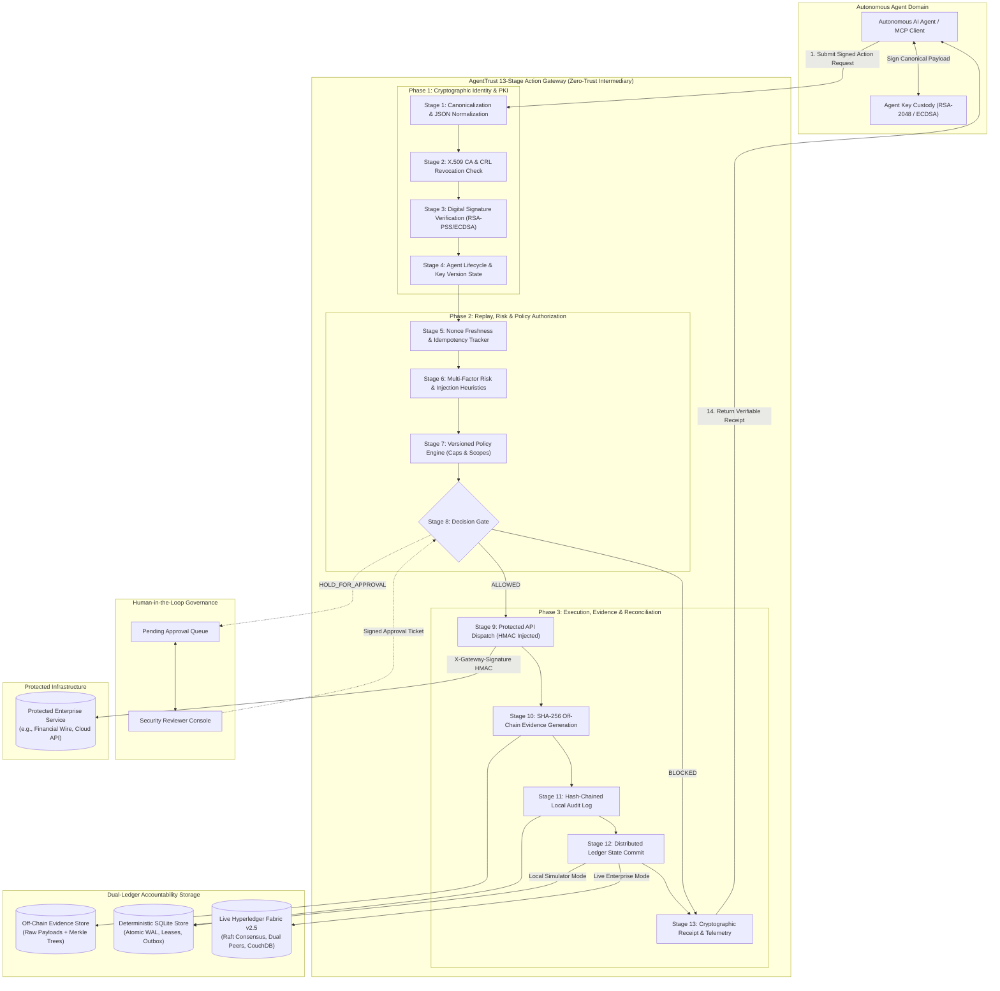
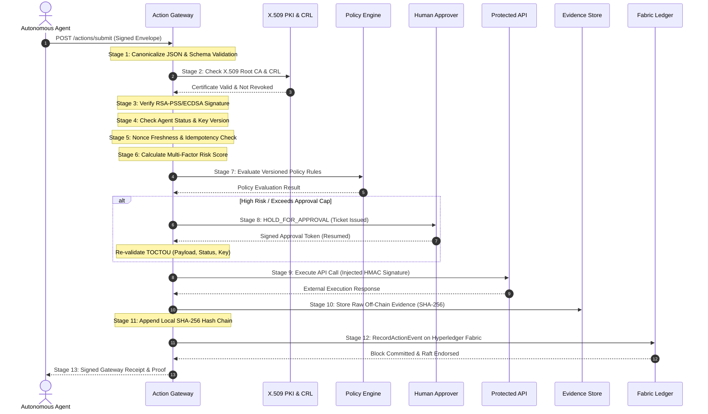

<div align="center">

# 🛡️ AgentTrust

### **Enterprise AI Agent Governance Framework: Verifiable Identity, Bounded Authorization, and Tamper-Evident Accountability for Autonomous AI Agents**

[](https://www.python.org/)
[](https://fastapi.tiangolo.com/)
[](frontend/)
[](frontend/)
[](fabric/)
[](LICENSE)
[](verify_all.py)
[](tests/)
[](verify_all.py)
[](documentation/security_model.md)
[-red)](attack_lab/)
[](benchmarks/DATASET_PROVENANCE.md)

[Overview](#-executive-overview) •
[Architecture](#-system-architecture) •
[13-Stage Gateway](#-the-13-stage-action-gateway-pipeline) •
[Core Governance Engines](#-core-governance-engines) •
[Live Hyperledger Fabric](#-live-multi-peer-hyperledger-fabric-v25-network) •
[Web Console (Next.js 16)](#-dual-monitoring-interfaces--nextjs-16-console) •
[Attack Lab Matrix](#-adversarial-attack-lab-20-scenarios) •
[Empirical Benchmarks](#-empirical-security-evaluation--benchmarks) •
[Quick Start](#-quick-start--installation) •
[SDK Usage](#-python-sdk-usage) •
[Verification & Reproducibility](#-automated-verification--reproducibility) •
[Documentation](#-documentation-index)

</div>

---

> ### 🛡️ Production & Release Verification Milestone
> **AgentTrust has achieved full release-candidate verification.**
> - **Verification Suite**: **5/5 stages passed** (`verify_all.py` — Ruff clean, Mypy clean on 83 source files, Pytest regression suite, Held-Out V2, Held-Out V3).
> - **End-to-End Workflows**: **7/7 demo workflows verified** (`scripts/e2e_demo_verification.py`).
> - **Frontend Console**: **14 static prerendered routes** generated cleanly with Next.js 16 (Turbopack) & React 19 (`frontend/`).
> - **Live Distributed Consensus**: Multi-peer **Hyperledger Fabric v2.5** network with Raft orderer, Org1 & Org2 peers, CouchDB, external chaincode (CCaaS), and Go SDK Gateway Bridge (`scripts/test_live_fabric_integration.py`).
> - **Database Baseline**: Clean, isolated, read-only verified baseline of **41 canonical demo agents**, 2 CRL revocations, 1 Root CA, and zero residue (`inspect_agenttrust_demo_db.py`).

---

## 📌 Executive Overview

As autonomous AI agents evolve from conversational chat interfaces into active operational workers, they are granted programmatic access to sensitive enterprise tools: executing wire transfers, triggering cloud infrastructure changes, issuing purchase orders, and mutating production databases.

This autonomy exposes a fundamental **Agent Security Trilemma**:

```
                  THE AGENT SECURITY TRILEMMA
                  
                      Cryptographic Identity
                     (Non-repudiable X.509 PKI)
                              ▲
                             / \
                            /   \
                           /     \
                          /       \
                         /  Agent  \
                        /   Trust   \
                       /             \
                      /               \
    Bounded Authorization ◄───────────► Tamper-Evident Accountability
  (13-Stage Pipeline & Policies)       (Merkle Evidence & Fabric Ledger)
```

1. **Shared Token Vulnerability (Identity Impersonation)**: Agents typically communicate with backend services using static, shared API keys or ambient credentials. If an agent key is leaked or compromised, attribution is impossible, and individual agents cannot be revoked without service downtime.
2. **Unbounded Operational Scope (Confused Deputy & Prompt Injections)**: Large Language Models are vulnerable to jailbreaking, context escape, indirect prompt injection, and hallucination. When an agent has broad API access, a compromised prompt can trick it into executing destructive API calls outside business policies.
3. **Audit Repudiation & Mutable Logs (Single-Database Failure)**: Traditional centralized audit databases can be modified, back-dated, or deleted by rogue administrators, compromised gateway instances, or database attackers.

### How AgentTrust Solves the Trilemma

**AgentTrust** is an enterprise-grade zero-trust governance gateway and accountability framework designed specifically for autonomous AI agents:

| Traditional API Gateways (Kong, Envoy) | AI Guardrail Filters (Llama Guard, NeMo) | **AgentTrust Framework** |
| :--- | :--- | :--- |
| Enforces static IP/OAuth tokens on human-facing services. | Evaluates text strings for toxic/adversarial content. | **Cryptographic X.509 PKI**: Asymmetric RSA-2048 / ECDSA digital signatures per agent, hardware-backed keys (PKCS#11 / HSM), and dynamic Certificate Revocation Lists (CRL). |
| Coarse route-level authorization (`GET /finance/*`). | No awareness of enterprise business limits or balances. | **13-Stage Pipeline & Versioned Policies**: Enforces monetary caps, working hours, resource scopes, and integer minor-unit canonicalization before execution. |
| Vulnerable to confused-deputy sub-agent execution. | Cannot govern tool parameters or downstream delegates. | **Intent-Bound MCP Governance**: Scopes Model Context Protocol tool calls and cryptographically binds delegated permissions to primary agent tokens. |
| Mutable SQL/NoSQL logging vulnerable to tamper. | Ephemeral telemetry without mathematical non-repudiation. | **Dual Tamper-Evident Ledgers**: SHA-256 off-chain evidence digests, local Merkle inclusion proofs, and immutable on-chain commits to multi-peer **Hyperledger Fabric v2.5**. |
| Race conditions and duplicate execution on retries. | No state machine or distributed concurrency control. | **Leased Locks & Durable Outbox**: Monotonic fencing tokens, distributed lease expiration, and idempotent status reconciliation. |

---

## 🏗️ System Architecture

AgentTrust acts as a zero-trust intermediary separating untrusted autonomous AI agent runtimes from protected enterprise APIs, databases, and financial systems.



### Dual-Ledger Operational Topology

AgentTrust provides two operational topologies:

1. **Deterministic Local Simulator (Zero-Dependency Mode)**:
   - Built on SQLite in Write-Ahead Logging (`WAL`) mode with atomic `BEGIN IMMEDIATE` transactions.
   - Provides instant startup with zero external container dependencies for development, unit testing, and CI/CD pipelines.
   - Fully implements local SHA-256 hash-chaining, Merkle inclusion proofs, and transactional outbox recovery.

2. **Enterprise Multi-Peer Hyperledger Fabric v2.5 (Production Consensus Mode)**:
   - Deploys a full 10-container enterprise Fabric network via Docker Compose (`fabric/docker-compose-fabric.yaml`).
   - Features **Raft crash fault tolerant ordering** (`orderer.agenttrust.com`), dual endorsing peers (`peer0.org1` and `peer0.org2`), CouchDB state indexes, Go SDK Gateway Bridge, and Chaincode-as-an-External-Service (CCaaS).
   - Enforces **strict fail-closed behavior**: if the live Fabric network becomes unreachable, transactions requiring immutable on-chain finality are held in the durable outbox (`reconciliation_queue`) rather than silently falling back to local simulation.

---

## 🔄 The 13-Stage Action Gateway Pipeline

Every action request submitted by an autonomous agent traverses 13 sequential security stages before touching any backend resource:



### Detailed Pipeline Stage Breakdown

| Phase | # | Stage Name | Implementation Module | Threat Mitigated & Security Invariant |
| :--- | :---: | :--- | :--- | :--- |
| **Identity** | **1** | **Canonicalization & Normalization** | [`action_gateway/validator.py`](action_gateway/validator.py) | **Payload Serialization Drift**: Normalizes JSON whitespace, key ordering, and unicode (NFKC) so signatures are mathematically deterministic. |
| | **2** | **X.509 Certificate & CRL Check** | [`identity_manager/pki.py`](identity_manager/pki.py) | **Rogue & Impersonated Keys**: Verifies X.509 certificate chain against Root CA; checks Certificate Revocation List (CRL). |
| | **3** | **Digital Signature Verification** | [`identity_manager/signature_verifier.py`](identity_manager/signature_verifier.py) | **Forged Signatures & Payload Tampering**: Validates RSA-PSS or ECDSA digital signature over canonicalized bytes using registered public key. |
| | **4** | **Agent & Key Lifecycle State** | [`agent_registry/status_manager.py`](agent_registry/status_manager.py) | **Zombie & Compromised Agents**: Rejects agents in `SUSPENDED` or `REVOKED` state; verifies active key version matches registration. |
| **Policy & Risk** | **5** | **Replay & Idempotency Tracker** | [`replay_protection/nonce_tracker.py`](replay_protection/nonce_tracker.py) | **Replay Attacks & Accidental Retries**: Verifies timestamp is within skew window ($\pm 300\text{s}$); enforces single-use nonces and idempotency fingerprints. |
| | **6** | **Multi-Factor Risk Scoring** | [`risk_engine/risk_calculator.py`](risk_engine/risk_calculator.py) | **Risk Spoofing & Prompt Injections**: Re-calculates risk independently on server (ignoring client headers); runs regex, entropy, and injection heuristics. |
| | **7** | **Versioned Policy Engine** | [`policy_engine/evaluator.py`](policy_engine/evaluator.py) | **Unauthorized Execution & Overspending**: Checks allowed action whitelist, resource scopes, monetary transaction caps, and UTC business hours. |
| | **8** | **Decision Gate & HITL Token** | [`action_gateway/gateway.py`](action_gateway/gateway.py) | **TOCTOU Approval Vulnerabilities**: Emits `ALLOW`, `BLOCK`, or `HOLD_FOR_APPROVAL`. Enforces cryptographic token binding upon human resumption. |
| **Execution & Audit** | **9** | **Protected API Dispatch** | [`protected_api/finance_api.py`](protected_api/finance_api.py) | **Direct Gateway Bypass**: Dispatches call to target API injected with secret HMAC `X-Gateway-Signature`; target rejects unauthenticated requests. |
| | **10** | **Off-Chain Evidence Digest** | [`evidence_manager/store.py`](evidence_manager/store.py) | **Repudiation of Inputs/Outputs**: Computes SHA-256 digest of request payload and response body; stores raw evidence in tamper-evident store. |
| | **11** | **Hash-Chained Audit Logging** | [`audit_writer/hash_chain.py`](audit_writer/hash_chain.py) | **Log File Modification**: Links every transaction into a local backward-linked SHA-256 cryptographic chain ($H_n = \text{SHA256}(H_{n-1} \parallel D_n)$). |
| | **12** | **Distributed Ledger Commit** | [`fabric/ledger_service.py`](fabric/ledger_service.py) | **Single-Database Tampering**: Commits action event digest and proof to Hyperledger Fabric v2.5 multi-peer network (or local simulator). |
| | **13** | **Telemetry & Signed Receipt** | [`action_gateway/gateway.py`](action_gateway/gateway.py) | **Traceability**: Emits Prometheus/structured telemetry and returns signed gateway receipt with transaction ID and block index to caller. |

---

## ⚙️ Core Governance Engines

### 1. Model Context Protocol (MCP) Governance
Autonomous agents relying on the **Model Context Protocol (MCP)** frequently call dynamic tools (e.g., database tools, filesystem tools, payment tools). AgentTrust's MCP Adapter ([`action_gateway/mcp_adapter.py`](action_gateway/mcp_adapter.py)) intercepts tool invocations before execution:
- **Parameter-Bound Intent**: Binds tool names and arguments directly to signed agent intent envelopes.
- **Confused Deputy Mitigation**: Prevents prompt injection attacks that attempt to weaponize benign tools to exfiltrate data or perform unauthorized side effects.

### 2. Leased Locks with Monotonic Fencing Tokens
In multi-worker environments, network latency and garbage collection pauses can cause split-brain races:
- **TTL-Leased Locks**: In-flight transactions acquire a lease in `in_flight_locks` with a strictly bounded time-to-live (`ttl_seconds`).
- **Monotonic Fencing Tokens**: Every lock acquisition or lease renewal increments an atomic integer fencing token. If worker $W_1$ stalls and worker $W_2$ reclaims the lease, $W_1$'s subsequent write attempt is rejected fail-closed with `STALE_FENCING_TOKEN`.

### 3. Financial Amount Canonicalization (Minor Units)
Floating-point arithmetic in financial transactions is prone to precision loss and rounding attacks:
- **Scale-4 Minor Units**: Amounts are converted to integer minor units (e.g., $\$1,250.50 \to 12505000$) and canonical decimal strings (`"1250.5000"`).
- **Domain Rejection**: Negative values, zero amounts, `NaN`, and `Infinity` are rejected fail-closed at Stage 1 before reaching the policy engine.

### 4. Human-in-the-Loop (HITL) with TOCTOU Protection
When an action exceeds configured risk thresholds (e.g., transfers over $\$10,000$):
- **Approval Ticket Issuance**: The transaction is placed in `HOLD_FOR_APPROVAL` with an issued single-use cryptographically signed approval ticket.
- **Time-of-Check to Time-of-Use (TOCTOU) Invariant**: When the human reviewer approves the ticket, the gateway does **not** blindly execute. It re-canonicalizes the payload, verifies that the agent certificate has not been revoked in the interim, verifies that policy caps have not drifted, and ensures the ticket has not been previously consumed.

### 5. Durable Transaction Intent State Machine
Transaction intents follow a strictly enforced acyclic directed state graph:

$$\text{PENDING\_AUTHORIZATION} \longrightarrow \text{AUTHORIZED\_PENDING\_EXECUTION} \longrightarrow \text{EXECUTED\_PENDING\_LEDGER} \longrightarrow \text{COMMITTED}$$

- **Terminal States**: `REJECTED`, `FAILED`, and `DEAD_LETTER`.
- **Illegal Transitions**: Attempting backward or skipping transitions (e.g., `COMMITTED` $\to$ `PENDING_AUTHORIZATION`) raises an `InvalidStateTransitionError`.
- **Durable Outbox**: If external execution succeeds but ledger commit fails, the record is placed in `reconciliation_queue` (`LEDGER_COMMIT_PENDING_RETRY`) and reconciled by an idempotent background worker.

---

## 🌐 Live Multi-Peer Hyperledger Fabric v2.5 Network

AgentTrust provides a live, production-grade Hyperledger Fabric v2.5 deployment:

```
Hyperledger Fabric v2.5 Network Architecture
─────────────────────────────────────────────────────────────────────────────
[orderer.agenttrust.com] ── Raft Consensus (Port 7050)
        │
        ├── [peer0.org1.agenttrust.com] ── Port 7051 ── CouchDB0 Org1 (Port 5984)
        │         ▲
        │         │ Gossip Protocol (Channel: agenttrust-channel)
        │         ▼
        ├── [peer0.org2.agenttrust.com] ── Port 9051 ── CouchDB0 Org2 (Port 6984)
        │
        ├── [agenttrust-cc (CCaaS)]    ── Port 9999 (External Chaincode Service)
        │
        └── [fabric-gateway-bridge]     ── Port 8090 (Go SDK REST Gateway Bridge)
                    ▲
                    │ HTTP/REST (Port 8090)
                    ▼
          [AgentTrust Action Gateway / Server (Port 8000)]
```

### Verified Live Network Capabilities

The live multi-peer Fabric network is validated via [`scripts/test_live_fabric_integration.py`](scripts/test_live_fabric_integration.py):

1. **Raft Multi-Peer Consensus**: Real transaction proposals are submitted via the Go SDK Gateway Bridge, endorsed across organization peers, and committed to immutable ledger blocks by the Raft ordering service.
2. **On-Chain Cryptographic Tamper Detection**:
   - Chaincode stores the canonical SHA-256 evidence digest on-chain.
   - Calling `verify_evidence_hash` with authentic evidence returns `{"status": "VERIFIED", "verified": true}`.
   - Calling with a tampered hash immediately triggers on-chain tamper detection: `{"status": "TAMPERING_DETECTED", "verified": false}`.
3. **Strict Fail-Closed Enforcement**:
   - If the Fabric bridge becomes unreachable (e.g. simulated network partition on port `59999`), the gateway raises `RuntimeError: FABRIC_SUBMISSION_UNCERTAIN` and places the transaction into the durable recovery queue.
   - **Guaranteed Invariant**: The system **never** silently falls back to local simulation when live Fabric mode is active.

---

## 🖥️ Dual Monitoring Interfaces & Next.js 16 Console

AgentTrust provides two administrative and operational user interfaces:

### 1. Enterprise Next.js 16 (Turbopack) Console (`frontend/`)
A state-of-the-art web application built with **Next.js 16.3.8**, **React 19.2.8**, **Tailwind CSS v4**, and **TanStack Query**, featuring **14 prerendered routes**:

| Route | Purpose & Key Features |
| :--- | :--- |
| **`/overview`** | Real-time security posture, active agent counts, ledger block height, pending approvals badge, and live transaction throughput. |
| **`/agents`** | Complete agent lifecycle management: interactive registration modal, X.509 certificate viewer, suspension toggle, and CRL revocation. |
| **`/gateway`** | Interactive 13-stage pipeline request simulator, allowing operators to step through and inspect each verification phase. |
| **`/policies`** | Versioned policy manager: edit monetary caps, resource patterns, allowed action whitelists, and view rollback history. |
| **`/approvals`** | Human-in-the-Loop review queue: inspect payload parameters, risk scores, review tickets, and execute single-use approvals. |
| **`/ledger`** | Immutable block explorer: view block heights, previous hash pointers, transaction IDs, Merkle roots, and endorsement signatures. |
| **`/evidence`** | Off-chain evidence repository: view raw JSON payloads, inspect SHA-256 hashes, and download Merkle inclusion proofs. |
| **`/attack-lab`** | Interactive 20-scenario adversarial attack lab: trigger live attacks and monitor real-time gateway defense logs. |
| **`/benchmarks`** | Visual performance charts: latency distributions (p50/p95/p99), throughput comparisons across modes, and ablation metrics. |
| **`/sandbox`** | Operational testbed: trigger MCP tool invocations, inspect the durable retry outbox, and view active replay nonces. |

To run the Next.js console:
```bash
cd frontend
npm install
npm run dev
# Open http://localhost:3000
```

### 2. Built-in Lightweight HTML Security Console (`dashboard/`)
Zero external dependencies; served directly by the FastAPI backend at `http://localhost:8000`:
- Interactive attack-lab runner with live progress bar.
- Real-time audit log streaming and block inspector.
- Agent identity and policy management forms.

---

## 🧪 Adversarial Attack Lab (20 Scenarios)

The AgentTrust Attack Lab ([`attack_lab/`](attack_lab/)) systematically validates system defenses against 20 real-world adversarial attack vectors:

| # | Attack Scenario | Adversarial Threat Description | Gateway Prevention Stage | Resulting Defense Status |
| :-: | :--- | :--- | :--- | :--- |
| **01** | **Forged Signature** | Attacker signs request with an unregistered or forged keypair. | **Stage 3**: Signature Verification | `INVALID_SIGNATURE` (HTTP 401) |
| **02** | **Payload Tampering** | Attacker alters `amount` or `recipient` after digital signing. | **Stage 1 & 3**: Canonical Hash | `SIGNATURE_MISMATCH` (HTTP 401) |
| **03** | **Replay Attack** | Attacker captures and re-submits a previously valid signed packet. | **Stage 5**: Nonce Tracker | `REPLAY_DETECTED` (HTTP 409) |
| **04** | **Expired Request** | Request submitted with a timestamp outside the 300s window. | **Stage 5**: Timestamp Freshness | `REQUEST_EXPIRED` (HTTP 400) |
| **05** | **Duplicate Request** | Resending identical business action with existing idempotency key. | **Stage 5**: Idempotency Cache | Returns cached result without re-execution |
| **06** | **Revoked Agent** | Agent listed in Certificate Revocation List attempts execution. | **Stage 4**: CRL Verification | `AGENT_REVOKED` (HTTP 403) |
| **07** | **Suspended Agent** | Agent in administrative `SUSPENDED` status attempts execution. | **Stage 4**: Lifecycle Check | `AGENT_SUSPENDED` (HTTP 403) |
| **08** | **Unauthorized Action** | Agent attempts an API action not permitted in its policy whitelist. | **Stage 7**: Policy Engine | `ACTION_NOT_PERMITTED` (HTTP 403) |
| **09** | **Policy Cap Bypass** | Agent attempts monetary transaction exceeding policy limit. | **Stage 7**: Monetary Evaluator | `EXCEEDS_POLICY_CAP` (HTTP 403) |
| **10** | **Risk Score Spoofing** | Attacker injects client-side `risk_score=0.0` header. | **Stage 6**: Server-Side Recalculation | Header ignored; server re-evaluates risk |
| **11** | **Approval Tampering** | Client submits `status="APPROVED"` without an issued approval ticket. | **Stage 8**: Ticket State Verifier | `TICKET_REQUIRED` (HTTP 403) |
| **12** | **Ticket Replay** | Attacker attempts to reuse an already consumed approval ticket. | **Stage 8**: Single-Use Guard | `TICKET_ALREADY_USED` (HTTP 409) |
| **13** | **Ticket Substitution** | Attacker attempts to apply Ticket A to unauthorized Request B. | **Stage 8**: Payload Binding Hash | `TICKET_PAYLOAD_MISMATCH` (HTTP 400) |
| **14** | **Post-Approval Drift** | Payload modified between human approval and ticket resumption. | **Stage 8**: TOCTOU Re-Validation | `PAYLOAD_ALTERED` (HTTP 400) |
| **15** | **Direct API Bypass** | Attacker bypasses gateway to invoke protected API directly. | **Protected API**: HMAC Secret Guard | Missing `X-Gateway-Signature` (HTTP 401) |
| **16** | **Evidence Tampering** | Attacker alters stored off-chain JSON evidence in database. | **Evidence Verifier**: Merkle Checker | `EVIDENCE_TAMPERED` (Hash mismatch) |
| **17** | **Hash-Chain Tampering** | Historical block modified in local audit log storage. | **Audit Writer**: Pointer Validation | `HASH_CHAIN_BROKEN` (Chain invalid) |
| **18** | **Unauthorized Ledger Write** | Direct write attempt to ledger without gateway authorization. | **Ledger Service**: Role-Based Guard | `UNAUTHORIZED_WRITE` (HTTP 403) |
| **19** | **Key Compromise Recovery** | Automatic key rotation and certificate revocation upon leak. | **Identity Manager**: Key Revocation | Old cert revoked, new cert issued |
| **20** | **Concurrent Audit Conflict**| Multiple concurrent threads write to audit log simultaneously. | **Audit Writer**: WAL & Mutex Locking | Serialized atomic commits, zero loss |

Run the complete attack lab test suite:
```bash
pytest attack_lab/test_attack_lab.py -v
```

---

## 📊 Empirical Security Evaluation & Benchmarks

To establish an evidence-backed baseline, AgentTrust implements independent held-out evaluation datasets, Wilson Score 95% Confidence Intervals, and a 6-configuration normalization ablation study. Complete dataset provenance and labeling rules are documented in [`benchmarks/DATASET_PROVENANCE.md`](benchmarks/DATASET_PROVENANCE.md).

### 1. Generalization on Held-Out Datasets

| Benchmark Dataset | Size ($N$) | Threat Vectors Tested | Precision | Recall (95% CI) | False Positive Rate | Overall Accuracy |
| :--- | :---: | :--- | :---: | :---: | :---: | :---: |
| **Curated Frozen Benchmark (V1)** | 52 | Known injection patterns & enterprise tasks | 100.00% | 100.00% $[87.13\%, 100.00\%]$ | 0.00% | 100.00% |
| **Held-Out V1 (Unseen)** | 30 | Base64, zero-width, markdown exploits | 87.50% | 46.67% $[24.81\%, 70.45\%]$ | 6.67% | 70.00% |
| **Held-Out V2 (Novel Zero-Day)** | 30 | Cyrillic homoglyphs, context boundary breaks | 100.00% | 33.33% $[15.18\%, 58.29\%]$ | 0.00% | 66.67% |

> **Key Empirical Finding**: Heuristic and pattern-based prompt-injection detectors alone are **insufficient** as a standalone defense against novel adversarial attacks (Held-Out V2 recall is $33.33\%$). Complete defense-in-depth requires cryptographic non-repudiation and Layer 2 Bounded Policy Enforcement.

### 2. Granular Normalization Ablation Study (Held-Out V2)

Running `python benchmarks/ablation_study_benchmark.py` isolates each normalization operation across 6 distinct configurations:

| Configuration Variant | Isolated Operations | Attack Recall (95% CI) | Precision | False Positive Rate |
| :--- | :--- | :---: | :---: | :---: |
| **V1: Raw Patterns Only** | Regex heuristics with zero preprocessing | 13.33% $[3.74\%, 37.88\%]$ | 100.00% | 0.00% |
| **V2: Unicode NFKC Only** | Unicode canonical decomposition | 13.33% $[3.74\%, 37.88\%]$ | 100.00% | 0.00% |
| **V3: Homoglyphs Only** | Cyrillic & Greek confusable substitution | 20.00% $[7.05\%, 45.19\%]$ | 100.00% | 0.00% |
| **V4: Hex / Base64 Only** | Automatic payload decoding | 26.67% $[10.90\%, 51.95\%]$ | 100.00% | 0.00% |
| **V5: Combined Normalization**| NFKC + Homoglyphs + Hex/B64 decoding | 33.33% $[15.18\%, 58.29\%]$ | 100.00% | 0.00% |
| **V6: Multi-Layer Hybrid** | Normalization + Semantic Guardrail Engine | 33.33% $[15.18\%, 58.29\%]$ | 100.00% | 0.00% |

### 3. Adversarial Authorization Assurance (Side-Effect Verification)

In [`tests/test_authorization_assurance.py`](tests/test_authorization_assurance.py), we verify the critical safety invariant: **Does the authorization layer stop unauthorized actions even when the prompt-injection detector is completely bypassed?**
- Across all 15 adversarial payloads in Held-Out V2 (including all 10 payloads that bypassed prompt detection), the 13-stage action gateway enforced a **100% fail-closed block rate**.
- Direct inspection of the protected financial service confirmed: **0 unauthorized wire transfers occurred** (zero financial side effects).
- Benign positive control requests within policy bounds executed cleanly (`ALLOWED`), proving the system is not trivially denying all requests.

---

## 🚀 Quick Start & Installation

### 1. Prerequisites
- **Python**: 3.11 or higher
- **Node.js**: 20+ (required for Next.js console in `frontend/`)
- **Docker & Docker Compose**: (Required for live Hyperledger Fabric network)

### 2. Clone & Environment Setup
```bash
# Clone repository
git clone https://github.com/venkatesh0029/AgentTrust.git
cd AgentTrust

# Create & activate virtual environment
python -m venv .venv
# On Linux/macOS:
source .venv/bin/activate
# On Windows (PowerShell):
.venv\Scripts\Activate.ps1

# Install Python dependencies
pip install -r requirements.txt
```

### 3. Launch the Gateway Server
```bash
uvicorn server:app --reload --port 8000
```
- 🌐 **Interactive Security Dashboard**: [http://localhost:8000](http://localhost:8000)
- 📚 **Interactive Swagger API Docs**: [http://localhost:8000/docs](http://localhost:8000/docs)
- 📖 **ReDoc Specifications**: [http://localhost:8000/redoc](http://localhost:8000/redoc)

### 4. Launch the Next.js 16 Console
```bash
cd frontend
npm install
npm run dev
# Console accessible at http://localhost:3000
```

### 5. Launch the Live Hyperledger Fabric Network (Optional)
```bash
# Start all 10 Fabric containers (Raft orderer, Org1 peer, Org2 peer, CouchDB, CCaaS, Bridge)
docker compose -f fabric/docker-compose-fabric.yaml up -d

# Verify live Fabric multi-peer consensus
python scripts/test_live_fabric_integration.py
```

---

## 💻 Python SDK Usage

The Python SDK ([`agenttrust_sdk/`](agenttrust_sdk/)) provides high-level client abstractions for agents to interact securely with the AgentTrust gateway.

### Register an Agent & Submit an Action

```python
import rsa
from agenttrust_sdk.agent_guard import AgentGuard

# 1. Initialize SDK connected to the AgentTrust Gateway
guard = AgentGuard(gateway_url="http://localhost:8000")

# 2. Generate local RSA keypair (private key stays with agent)
pubkey, privkey = rsa.newkeys(2048)

# 3. Register agent identity with the gateway
agent_info = guard.register_agent(
    agent_id="FINANCE-AGENT-001",
    public_key_pem=pubkey.save_pkcs1().decode("utf-8"),
    roles=["FINANCE_OPERATOR"]
)
print(f"Agent Registered: {agent_info['agent_id']} (Status: {agent_info['status']})")

# 4. Submit an authenticated, cryptographically signed action
response = guard.submit_action(
    agent_id="FINANCE-AGENT-001",
    private_key_pem=privkey.save_pkcs1().decode("utf-8"),
    action="TRANSFER_FUNDS",
    resource="TREASURY_ACCOUNT",
    amount=2500.00,
    parameters={"recipient": "vendor-corp-99", "currency": "USD"}
)

print(f"Decision: {response['decision']} | Request ID: {response['request_id']}")
```

### Independent Merkle Evidence Verification

Off-chain evidence files can be verified mathematically without trusting the central server, using [`auditor_cli.py`](auditor_cli.py):

```bash
# Verify off-chain evidence against an on-chain Merkle root proof
python auditor_cli.py \
  --verify-proof \
  --evidence evidence_rec_1001.json \
  --root 9f8a3c4b... \
  --proof proof_1001.json
```

---

## 🔬 Automated Verification & Reproducibility

AgentTrust includes a comprehensive suite of verification tools to guarantee code quality, database hygiene, and deterministic test reproducibility:

### 1. 5-Stage Automated Verification Suite (`verify_all.py`)
Runs the complete self-verification pipeline:
```bash
python verify_all.py
```
- **Stage 1**: Ruff static analysis and linting (`ruff check .`)
- **Stage 2**: Mypy strict type checking across all 83 core files
- **Stage 3**: Full Pytest regression test suite (265 passing tests)
- **Stage 4**: Held-Out V2 zero-day adversarial benchmark
- **Stage 5**: Held-Out V3 zero-day adversarial benchmark

### 2. 7/7 End-to-End Demo Workflows (`scripts/e2e_demo_verification.py`)
Validates all seven core operational user journeys against the running server:
```bash
python scripts/e2e_demo_verification.py
```
1. `Dashboard & Ledger`: Verifies hash-chain integrity and blockchain block counts.
2. `Agent Registration & Policies`: Enforces role-based administration and policy boundaries.
3. `Gateway & Evidence`: Submits 13-stage action, retrieves provenance, and validates Merkle proofs.
4. `Identity & Delegation`: Inspects X.509 certs, issues delegation tokens, and verifies role checks.
5. `Empirical Benchmarks`: Executes live multi-mode benchmark and ablation measurements.
6. `Attack Lab`: Runs all 20 adversarial scenarios with 100% block verification.
7. `Operational Sandbox`: Inspects retry queues, validates replay cache, and triggers MCP tool calls.

### 3. Read-Only Demo Database Inspector (`inspect_agenttrust_demo_db.py`)
Inspects the persistent SQLite database without writing to ensure zero transient test pollution:
```bash
python inspect_agenttrust_demo_db.py
```
- Enforces exact clean baseline: **41 registered agents** (37 active, 2 suspended, 2 revoked), 2 CRL revocations, 1 Root CA, 1 genesis block, and 0 residue records in human approvals, evidence, or in-flight locks.

### 4. Fresh Isolated Bootstrap Test (`scripts/test_clean_bootstrap.py`)
Creates an ephemeral, isolated temporary database, seeds it from scratch, verifies certificate signatures and revocation enforcement, and tears it down cleanly:
```bash
python scripts/test_clean_bootstrap.py
```

### 5. Live Multi-Peer Fabric Integration Test (`scripts/test_live_fabric_integration.py`)
Connects to the running Docker Fabric network, submits real transactions, verifies Raft consensus commitment, executes on-chain tamper detection, and proves fail-closed behavior:
```bash
python scripts/test_live_fabric_integration.py
```

---

## 📁 Repository Structure

```
AgentTrust/
├── server.py                        # FastAPI main application server & REST routes
├── verify_all.py                    # 5-stage automated reproducibility & verification suite
├── inspect_agenttrust_demo_db.py    # Read-only demo database inspection tool
├── auditor_cli.py                   # Independent Merkle inclusion proof verification CLI
├── benchmark.py                     # Multi-mode latency & throughput benchmark harness
├── cache_manager.py                 # Thread-safe TTL cache manager
├── agenttrust_persistent.db         # Persistent demo database (clean 41-agent baseline)
│
├── action_gateway/                  # 13-Stage Action Gateway core pipeline
│   ├── gateway.py                   # Gateway dispatcher & execution coordinator
│   ├── validator.py                 # Canonical JSON & schema validator
│   ├── mcp_adapter.py               # Model Context Protocol (MCP) tool governance
│   └── pipeline.py                  # Sequential 13-stage pipeline executor
│
├── identity_manager/                # Cryptographic Identity & PKI
│   ├── pki.py                       # Root CA, X.509 issuance, & CRL manager
│   ├── key_store.py                 # Key storage & PKCS#11 SoftHSM2 manager
│   ├── signature_verifier.py        # RSA-PSS & ECDSA signature verifier
│   ├── jwt_auth.py                  # Administrative JWT tokens & RBAC
│   └── delegation_tokens.py         # Sub-agent delegation token issuer & verifier
│
├── agent_registry/                  # Agent Lifecycle & RBAC
│   ├── registry.py                  # Agent CRUD & SQLite repository
│   ├── status_manager.py            # ACTIVE / SUSPENDED / REVOKED state machine
│   └── rbac.py                      # Role-based access control engine
│
├── policy_engine/                   # Policy Evaluation & History
│   ├── policy_store.py              # Versioned policy registry & rollback manager
│   ├── evaluator.py                 # Fine-grained policy rule evaluator
│   └── models.py                    # Pydantic policy schemas & minor units
│
├── risk_engine/                     # Risk & Prompt Injection Detection
│   ├── risk_calculator.py           # Multi-factor risk calculation engine
│   └── injection_heuristics.py      # Entropy & adversarial pattern analyzer
│
├── replay_protection/               # Replay & Concurrency Controls
│   ├── nonce_tracker.py             # Single-use nonce tracker & timestamp validator
│   ├── idempotency.py               # Payload-fingerprinted idempotency cache
│   └── distributed_lock.py          # Leased locks with monotonic fencing tokens
│
├── human_approval/                  # Human-in-the-Loop Governance
│   └── approval_manager.py          # Approval ticket issuance & TOCTOU re-validator
│
├── protected_api/                   # Protected Enterprise Infrastructure
│   └── finance_api.py               # Sample financial wire transfer API (HMAC protected)
│
├── evidence_manager/                # Off-Chain Evidence & Merkle Proofs
│   ├── store.py                     # Raw payload evidence store
│   ├── hashing.py                   # SHA-256 payload digest calculator
│   └── merkle.py                    # Merkle tree generator & inclusion proof builder
│
├── audit_writer/                    # Tamper-Evident Local Audit Engine
│   ├── hash_chain.py                # Backward-linked SHA-256 cryptographic chain
│   └── writer.py                    # Atomic WAL audit log writer
│
├── fabric/                          # Hyperledger Fabric Live Integration & Simulator
│   ├── docker-compose-fabric.yaml   # 10-container multi-peer Fabric network definition
│   ├── fabric_client.py             # REST client for Go SDK Gateway Bridge
│   ├── ledger_service.py            # Dual ledger dispatcher (live vs simulator)
│   ├── persistent_db.py             # SQLite persistence manager for Fabric state
│   ├── chaincode/                   # Reference Go smart contract (`agenttrust.go`)
│   ├── production_deployment_guide.md # Multi-org production deployment manual
│   └── retry_recovery_runbook.md    # Operational incident response runbook
│
├── frontend/                        # Enterprise Web Console (Next.js 16 Turbopack)
│   ├── package.json                 # Next.js 16, React 19, Tailwind CSS v4
│   ├── src/app/(console)/           # 14 static prerendered routes
│   │   ├── overview/                # System health & metric widgets
│   │   ├── agents/                  # Agent registry & certificate inspector
│   │   ├── gateway/                 # 13-stage request pipeline simulator
│   │   ├── policies/                # Policy editor & version history
│   │   ├── approvals/               # Human approval ticket queue
│   │   ├── ledger/                  # Block explorer & transaction inspector
│   │   ├── evidence/                # Off-chain evidence & Merkle verifier
│   │   ├── attack-lab/              # 20-scenario adversarial attack runner
│   │   ├── benchmarks/              # Latency & throughput charts
│   │   └── sandbox/                 # MCP tool caller & outbox inspector
│   └── public/                      # Static assets & icons
│
├── attack_lab/                      # Adversarial Security Testing Lab
│   └── test_attack_lab.py           # 20 adversarial attack threat implementations
│
├── benchmarks/                      # Empirical Benchmarks & Datasets
│   ├── ablation_study_benchmark.py  # 6-configuration normalization ablation harness
│   ├── held_out_v2_benchmark.py     # Novel zero-day injection dataset evaluator
│   ├── held_out_v3_benchmark.py     # Metamorphic boundary break benchmark
│   └── DATASET_PROVENANCE.md        # Dataset provenance & Wilson CI methodology
│
├── scripts/                         # Operational & Verification Scripts
│   ├── e2e_demo_verification.py     # 7/7 end-to-end workflow verification script
│   ├── test_live_fabric_integration.py # Live multi-peer Fabric consensus test suite
│   ├── test_clean_bootstrap.py      # Fresh database bootstrap test in isolated tmpdir
│   ├── reset_demo_data.py           # Controlled demo state reset utility
│   └── rotate_development_keys.py   # Development Root CA & agent key rotation tool
│
├── documentation/                   # Architectural & Security Specifications
│   ├── complete_project_overview.md # Comprehensive executive overview
│   ├── architecture.md              # In-depth architectural specification
│   ├── threat_model.md              # Formal STRIDE threat model & boundaries
│   ├── security_model.md            # Statement of 12 security invariants
│   ├── api_specification.md         # Complete OpenAPI / Swagger REST API catalog
│   ├── standards_alignment.md       # Compliance mapping: ISO 27001, SOC 2, NIST AI RMF
│   ├── getting_started.md           # Developer onboarding guide
│   └── limitations.md               # Engineering limitations & honesty disclosures
│
└── tests/                           # Automated Test Suite (265 Passing Tests)
    ├── test_adversarial_security.py
    ├── test_authorization_assurance.py
    ├── test_concurrency_and_recovery.py
    ├── test_distributed_system_invariants.py
    ├── test_fabric_live_network.py
    ├── test_kms_softhsm2.py
    ├── test_policy_bypass_resilience.py
    ├── test_property_based.py
    └── test_security_invariants.py
```

---

## 🔒 The 12 Core Security Invariants

AgentTrust enforces 12 verifiable security invariants across every transaction:

1. **Unregistered Agent Invariant**: Agents without a valid, CA-signed X.509 certificate registered in the database cannot execute actions.
2. **Cryptographic Non-Repudiation Invariant**: Actions lacking a valid RSA-PSS or ECDSA digital signature over canonicalized JSON are rejected.
3. **Revocation Invariant**: Suspended or revoked agents (present in the CRL) are blocked fail-closed from executing actions.
4. **Replay Invariant**: Requests with previously consumed nonces or timestamps outside the allowed skew window ($\pm 300\text{s}$) are rejected.
5. **Bounded Scope Invariant**: Actions violating monetary caps, unlisted API endpoints, or working hours are prevented.
6. **Human-in-the-Loop Invariant**: High-risk actions cannot proceed to execution without an issued, unconsumed human approval ticket.
7. **Anti-TOCTOU Invariant**: Requests altered between human approval and execution are rejected via payload binding hash re-verification.
8. **Independent Risk Invariant**: Client-supplied risk scores are strictly ignored; risk is re-computed server-side.
9. **Tamper-Evident Evidence Invariant**: Any post-facto modification of off-chain evidence payloads is cryptographically detectable via SHA-256 digest comparison against the ledger.
10. **Immutable Ledger Invariant**: Direct or unauthorized attempts to alter historical blocks in the hash chain or Fabric ledger fail consensus checks.
11. **Atomic Audit Failure Invariant**: If audit logging or ledger persistence fails, the transaction is aborted atomically; no unprotected side effects occur.
12. **Idempotent Side-Effect Invariant**: Retrying a transaction with an identical idempotency key returns the cached outcome without repeating external side effects.

---

## ⚠️ Limitations & Transparent Disclosures

In the spirit of rigorous academic and engineering honesty, we explicitly document the system's operational boundaries:

1. **Prompt Injection is Not a Silver Bullet**: As empirically demonstrated in our Held-Out V2 benchmark (33.33% recall on novel vectors), pattern-based heuristic filters cannot prevent all prompt injection attacks. AgentTrust relies on **Layer 2 Bounded Authorization** (monetary limits, resource whitelists, and human approval) as the decisive security boundary when semantic detection fails.
2. **Single-Host vs Multi-Host Persistence**: The default SQLite database with Write-Ahead Logging (`WAL`) provides robust multiprocess concurrency on a single physical host. Multi-host production deployments require a distributed persistence tier (e.g. PostgreSQL with row-level locks or etcd/Consul) for distributed lease coordination.
3. **External System Idempotency Assumption**: Guaranteed at-most-once execution during network partition timeouts requires downstream enterprise APIs to honor durable idempotency keys and provide an authoritative transaction status query.

---

## 📜 Academic Citation

If you use AgentTrust in your academic research, enterprise architecture, or security evaluation, please cite:

```bibtex
@software{agenttrust2026,
  title        = {AgentTrust: Enterprise AI Agent Governance Framework: Verifiable Identity, Bounded Authorization, and Tamper-Evident Accountability for Autonomous AI Agents},
  author       = {Venkatesh},
  year         = {2026},
  url          = {https://github.com/venkatesh0029/AgentTrust},
  version      = {0.4.0}
}
```

---

## 👨‍💻 Author & Maintainer

**Venkatesh**  
GitHub: [@venkatesh0029](https://github.com/venkatesh0029)  
*B.Tech in Computer Science and Engineering (Specialization in Blockchain Technology)*  
*SRM Institute of Science and Technology*

---

<div align="center">
  <sub>Built with ❤️ for secure, verifiable, and accountable autonomous AI agent ecosystems. Distributed under the <a href="LICENSE">MIT License</a>.</sub>
</div>
