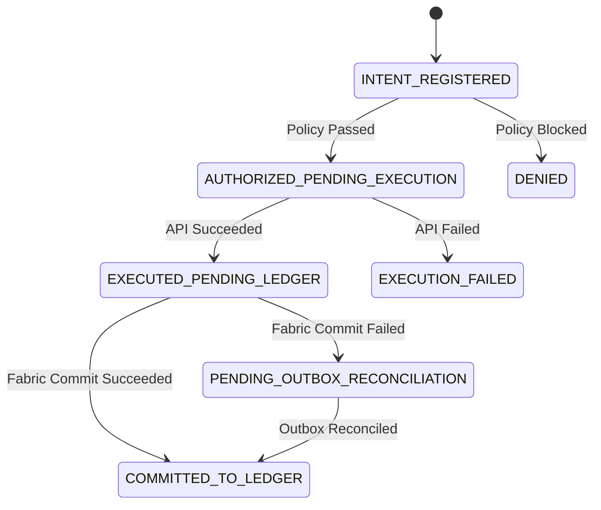

# AgentTrust — Independent Adversarial Review Guide

## 1. Purpose & Scope
This guide is structured for independent security auditors, peer engineers, and external security researchers conducting an independent code and architecture review of **AgentTrust**.

Instead of relying solely on existing automated test suites, this guide directs reviewers to the exact trust boundaries, critical code paths, state transition invariants, and failure scenarios where security vulnerabilities commonly arise in autonomous AI agent gateways.

---

## 2. Core Review Checklist for External Reviewers

### Area 1: Cryptographic Identity & Authorization Paths
* **Target Modules**: `action_gateway/gateway.py`, `agent_registry/registration.py`, `identity_manager/signature_manager.py`
* **Inspection Questions**:
  1. *Canonical Serialization*: Can an attacker introduce non-canonical JSON keys, whitespace variations, or floating-point formatting to produce signature verification bypasses?
  2. *Key Lifecycle & Version Binding*: When an agent key is rotated or revoked in `crl_revocations`, do pending or concurrent requests signed with older key versions fail immediately?
  3. *Delegation Chain Validation*: Can a sub-agent exceed the financial cap or action scope granted by the root agent's delegation token?
  4. *Direct Protected API Bypass*: Can an attacker forge the internal gateway secret or service RSA signature to invoke `ProtectedFinanceAPI` directly?

### Area 2: Fencing Logic & Downstream Boundary Enforcement
* **Target Modules**: `protected_api/finance_api.py`, `replay_protection/request_tracker.py`, `fabric/persistent_db.py`
* **Inspection Questions**:
  1. *Resource Scoping*: Are fencing tokens strictly scoped to the underlying financial asset (`target_account`, `supplier_id`) rather than solely to process IDs or transient worker keys?
  2. *Durable Fencing Persistence*: Does `ProtectedFinanceAPI` persist the highest accepted fencing token to SQLite so that a service restart does not allow a stale worker to execute with an old token?
  3. *Split-Brain Preemption*: If Worker 1 validates its lease in the gateway, experiences a garbage-collection or network stall, and Worker 2 acquires the lease with an incremented fencing token, does Worker 1 get rejected when finally calling the finance API?

### Area 3: Financial Precision & Payment Contract Invariants
* **Target Modules**: `action_gateway/gateway.py` (`canonicalize_financial_amount`, `CURRENCY_PRECISION_SPECS`)
* **Inspection Questions**:
  1. *Unsupported Currency Rejection*: If a transaction specifies an unapproved currency (e.g. `currency="XYZ"`), is it rejected fail-closed with `UNSUPPORTED_CURRENCY` rather than silently adopting a default 4-decimal scale?
  2. *Excess Precision Handling*: Does the gateway reject fractional amounts exceeding currency scale (e.g., `USD 100.505` or `JPY 5000.5`) before any policy evaluation?
  3. *Zero Float Drift*: Is the transaction amount preserved as exact integer minor units and canonical string from authorization through to the audit ledger and downstream database?

### Area 4: Durable Outbox, Recovery & Crash Boundaries
* **Target Modules**: `action_gateway/retry_queue.py`, `fabric/persistent_db.py`
* **Inspection Questions**:
  1. *Crash Boundary 2 (During External Side Effect)*: If a worker process crashes while executing an external API call, does recovery safely query authoritative status before attempting retry?
  2. *Crash Boundary 3 (After API, Before Ledger)*: If the external API succeeds but the blockchain ledger commit fails, does the durable outbox reconcile the audit log without triggering duplicate financial side effects?
  3. *Outbox Retry Exhaustion*: Does the exponential backoff queue cap retries and quarantine repeatedly failing events into a dead-letter queue with alerting?
  4. *Circuit Breaker Halting*: If ledger writes fail persistently, does the gateway trip its circuit breaker and fail-closed against new financial transactions?

### Area 5: Multi-Process Concurrency & Distributed Assumptions
* **Target Modules**: `replay_protection/request_tracker.py`, `fabric/persistent_db.py`
* **Inspection Questions**:
  1. *Single-Host vs Multi-Host Boundary*: Does the documentation clearly distinguish single-host SQLite WAL coordination from distributed multi-node consensus (Raft/etcd)?
  2. *Clock Domain*: Does lease expiration rely on persistent UTC wall-clock timestamps rather than system uptime monotonic clocks that reset across host reboots?
  3. *Cross-Process Idempotency*: When multiple independent OS processes race an identical idempotency key, does SQLite uniqueness guarantee that exactly one worker executes?

---

## 3. Transaction Intent State Machine Invariants

Independent reviewers should inspect the formal state machine transitions in `PersistentStorageEngine`:

### Prohibited Transitions (Must Error Fail-Closed):
* `INTENT_REGISTERED` -> `EXECUTED_PENDING_LEDGER` (Bypassing authorization)
* `DENIED` -> `AUTHORIZED_PENDING_EXECUTION` (Resurrecting denied request)
* `COMMITTED_TO_LEDGER` -> `AUTHORIZED_PENDING_EXECUTION` (Re-execution of completed transaction)
* Any state change from a worker whose fencing token is stale or lease has expired.

---

## 4. Submitting Review Findings
If you identify a trust boundary bypass or invariant violation:
1. Formulate a reproducible test case demonstrating the failure mode.
2. Verify whether existing policy rules or circuit breakers block the payload.
3. Open a security advisory on the GitHub repository: `https://github.com/venkatesh0029/AgentTrust/security/advisories`.
